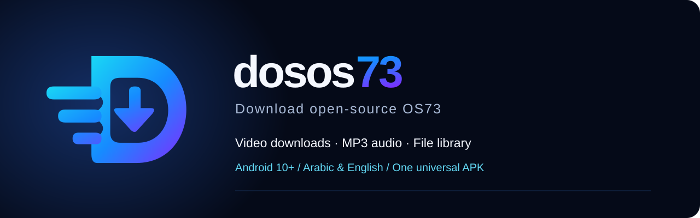
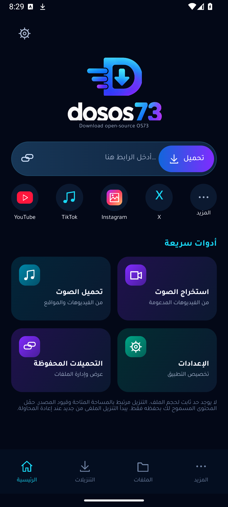
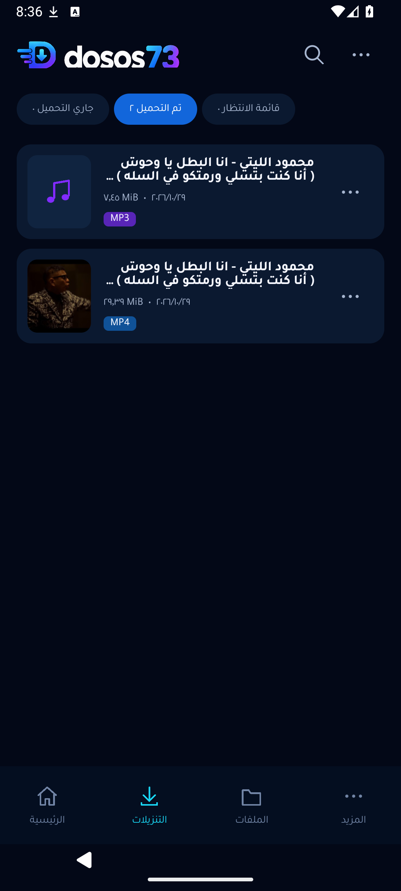
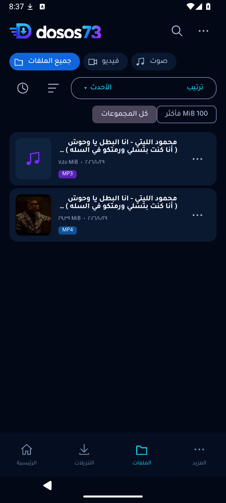
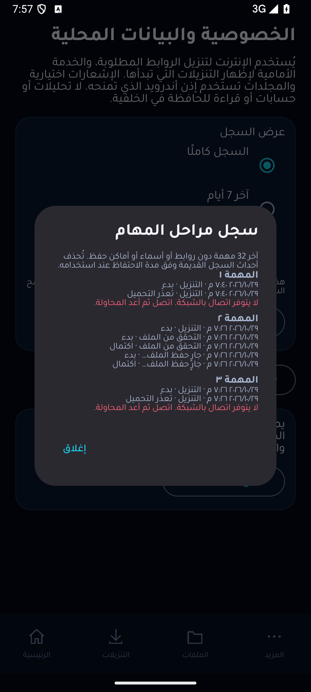
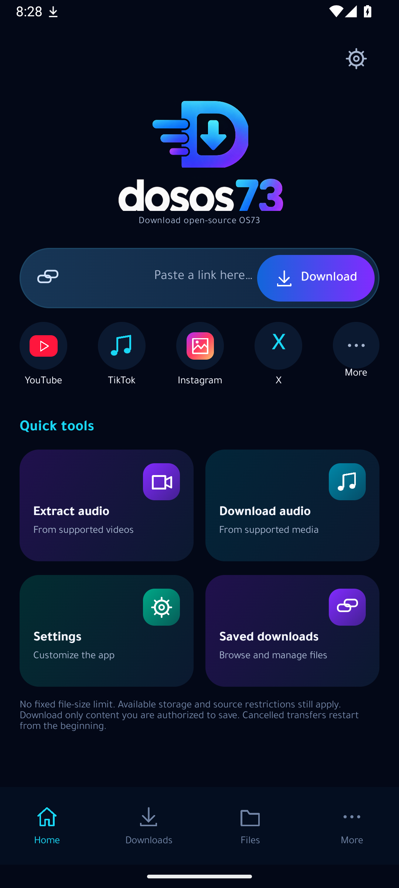
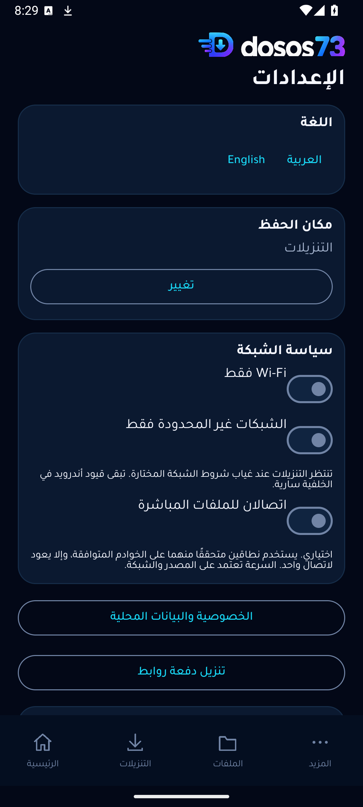

<div align="center">


# dosos73
**Download open-source OS73**

[](https://github.com/taroq4-2/dosos73/actions/workflows/android.yml)

مدير تنزيل وسائط مفتوح المصدر لأندرويد، بواجهة عربية ودعم الإنجليزية.

[تحميل APK الموحّد](https://github.com/taroq4-2/dosos73/releases/download/v1.2.0-rc.4/dosos73-1.2.0-rc.4-universal.apk) · [الإصدارات](https://github.com/taroq4-2/dosos73/releases) · [English](README.md)
</div>

## التنزيل والتوافق

الإصدار المرشّح **1.2.0-rc.4**: ملف APK واحد لأندرويد **10 فأحدث**، يضم ARM32 وARM64 وx86 وx86_64. لا تحتاج إلى اختيار نسخة لهاتف معيّن. راجع ملف البصمات المرفق بالإصدار للتحقق من التنزيل.

التحديثات الرسمية تستخدم شهادة التوقيع نفسها للحفاظ على البيانات. اسمح بالتثبيت من المتصفح أو مدير الملفات الذي اخترته عند طلب أندرويد ذلك. لا يتطلب لصق الرابط تنزيل مكتبات إضافية.

| الحزمة | التفاصيل |
|---|---|
| التنزيل الحالي | **1.2.0-rc.4** · إصدار مرشّح |
| حجم APK | **72.76 MB** ‏(69.39 MiB) |
| أندرويد المدعوم | **10 فأحدث** ‏(API 29+) |
| المعماريات | ARM32 وARM64 وx86 وx86_64، داخل ملف واحد |
| إخراج الصوت | **MP3 V0** |

[بصمات التحقق](https://github.com/taroq4-2/dosos73/releases/download/v1.2.0-rc.4/SHA256SUMS.txt) · [نتائج الاختبار](docs/VERIFICATION.md) · [الإبلاغ عن مشكلة](https://github.com/taroq4-2/dosos73/issues/new/choose)

## الوظائف

- لصق الرابط أو استقباله من مشاركة التطبيقات، ثم عرض الصيغ والجودات المتاحة.
- تنزيل الفيديو واستخراج الصوت بصيغة **MP3 V0** ودمج المسارات المتوافقة.
- ملفات مباشرة بلا حد ثابت للحجم؛ المساحة المتاحة وقيود المصدر تظل مؤثرة.
- استئناف مباشر مشروط بتطابق هوية المحتوى، وطابور محفوظ وأولويات وإعادة محاولة.
- مراجعة دفعات حتى 20 رابطًا، مع اختيار الصيغة والمجلد وحفظ المراجعة محليًا.
- حفظ متحقق منه بالبصمة، واسترداد الملفات عند انقطاع بعض مراحل النشر وإعادة التسمية.
- مكتبة للبحث والتصفية والمعاينة، مع تمييز فقد الملف محليًا عن رفض الوصول وعدم توافر التخزين.
- سجل مراحل مشفّر ومحدود للمهام، دون روابط أو أسماء ملفات أو بيانات دخول.
- العربية RTL والإنجليزية، وخط Tajawal والواجهة الداكنة، دون إعلانات أو تحليلات استخدام.

## الاستخدام

1. الصق رابطًا عامًا أو شاركه إلى التطبيق.
2. اختر نوع الوسائط والجودة والصيغة والمجلد بعد التحليل.
3. ابدأ التنزيل وتابع تقدمه من التنزيلات والإشعار.
4. افتح الملف المحفوظ من المكتبة بعد التحقق منه.

عند تعذّر استرداد ملف محفوظ، أعد توصيل التخزين وأعد محاولة **المهمة نفسها**. إعادة المحاولة تحاول استرداد الملف الموجود قبل بدء نقل جديد. بعض عمليات استخراج الوسائط تبدأ من جديد بعد الانقطاع؛ الاستئناف بالبايتات مخصص للمصادر المباشرة التي تسمح بإثبات تطابقها.

## صور فعلية

  



صور الرئيسية والتنزيلات والملفات والإعدادات ملتقطة من حزمة RC4 الموقّعة على محاكي أندرويد 15. صورة سجل المهام ملتقطة من بناء الاختبار المقابل؛ راجع [مصدر الصور](screenshots/README.md).

 

## حالة الإصدار

RC4 إصدار مرشّح؛ لم تُغلق بعد الجدولة المدعومة بالنظام، وتنزيل عدة ملفات نشطة، واختيار الترجمات، ومصفوفة الأجهزة والمزوّدات الفعلية. لا تعني نجاحات المحاكي اعتماد كل جهاز أو ترميز أو موقع.

[حالة المتطلبات](docs/REMAINING_REQUIREMENTS.md) · [اختبارات استرداد النشر](docs/PUBLICATION_RECOVERY.md) · [سجل المهام](docs/TASK_TIMELINE.md) · [توافر الملفات](docs/FILE_AVAILABILITY.md)

## أسئلة شائعة

**لماذا أربع معماريات؟** تعمل أجهزة أندرويد بمعالجات مختلفة. تضم الحزمة الموحّدة المحركات اللازمة لكل عائلة، ويستخدم أندرويد الملائم لجهازك. لا توجد نسخة مخصصة لطراز هاتف.

**لماذا الحجم نحو 73 MB؟** يتطلب الاستخراج وتحويل MP3 محركات مضمنة. خفّض بناء FFmpeg المضغوط حجمها، وتبقى جاهزة عند لصق الرابط دون تنزيل محرك عند أول استخدام.

**هل يمكن تنزيل كل فيديو؟** يتوقف ذلك على المصدر. لا يتجاوز التطبيق تسجيل الدخول أو المحتوى الخاص أو DRM أو قيود المنطقة والمصدر، ولا يعتبر الملف غير المكتمل تنزيلًا ناجحًا.

## البناء والمساهمة

يلزم JDK 17 أو 21 وAndroid SDK 35، مع مسار SDK محلي غير مضاف إلى المستودع.

```sh
./gradlew testDebugUnitTest lintDebug lintRelease assembleDebug assembleRelease
./gradlew connectedDebugAndroidTest
```

على ويندوز استخدم `gradlew.bat`. بناء Gradle العادي يُنتج حزمة الأساس؛ بناء المحرك المضغوط للمعماريات الأربع وتجميع الحزمة الموحّدة يتمان عبر [مسار البناء المثبّت](.github/workflows/compact-engine.yml) وأدوات `tools/`. يجب محاذاة الحزمة وتوقيعها والتحقق منها قبل النشر. مفاتيح التوقيع وملفات كلمات المرور ليست جزءًا من المستودع أو حزمة المصدر.

## الخصوصية والترخيص

لا حسابات داخل التطبيق ولا إعلانات ولا تحليلات استخدام. الوصول إلى الحافظة يتم عند اختيار اللصق. سجلات المهام الخاصة مشفّرة ومحفوظة على الجهاز، والنسخ الاحتياطي معطل. ملفات التنزيل وبيانات مكتبتها تبقى وفق مكان الحفظ الذي يختاره المستخدم. المصادر الخارجية ترى طلبات الشبكة وعنوان IP.

الكود الأصلي تحت **GPL-3.0-or-later**؛ تحتفظ المكتبات والخطوط والشعارات بشروطها. استخدم التنزيل للمحتوى المسموح لك بحفظه.

[الترخيص](LICENSE) · [إشعارات المكونات](THIRD_PARTY_NOTICES.md) · [الخصوصية](PRIVACY.md) · [المساهمة](CONTRIBUTING.md)
