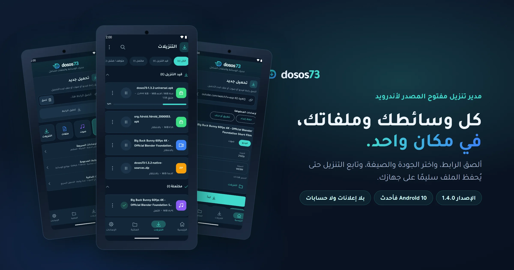
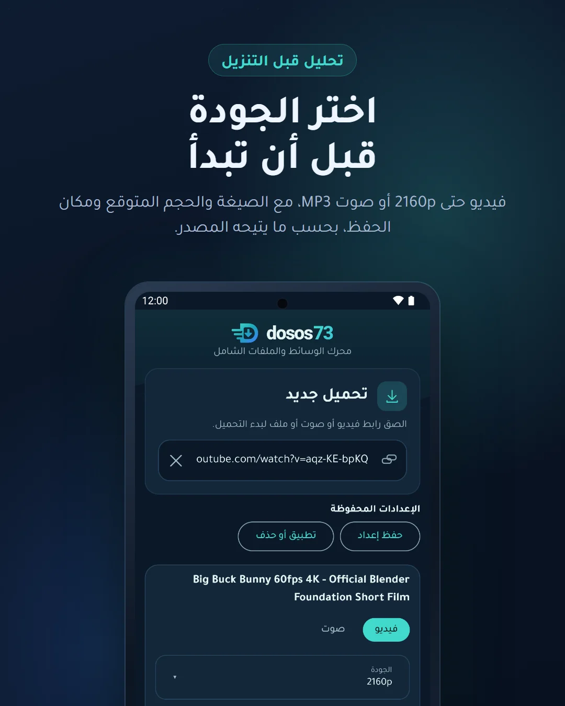
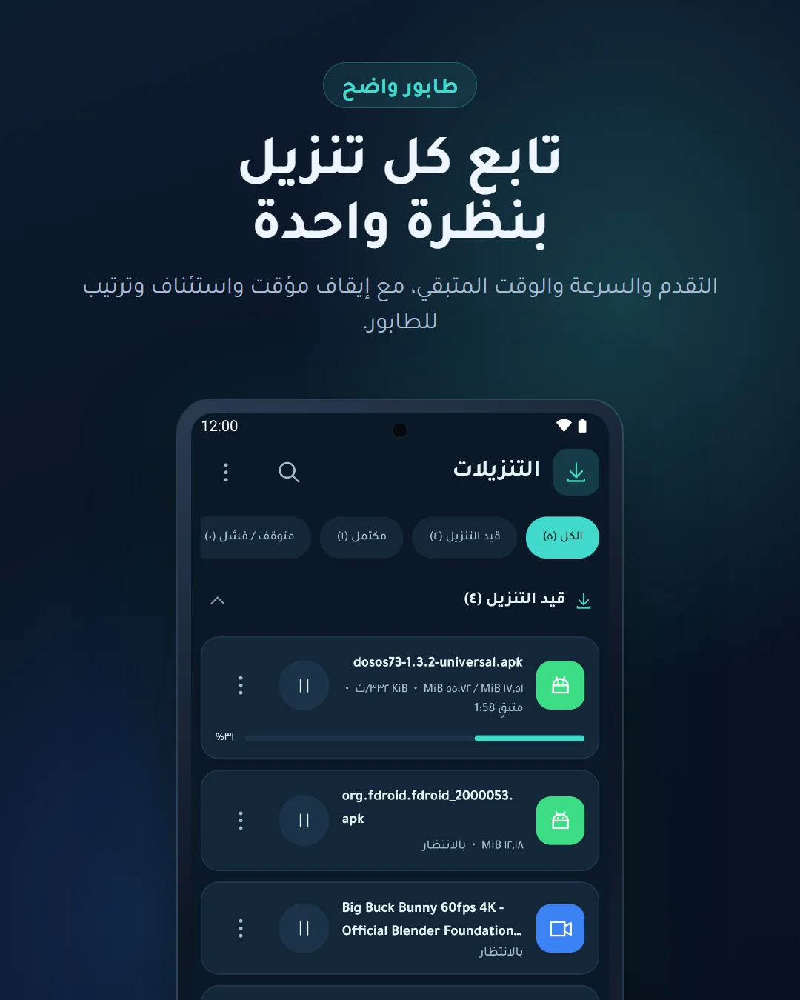
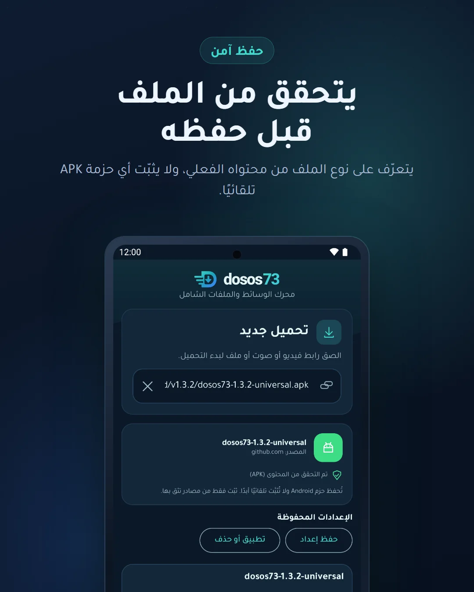
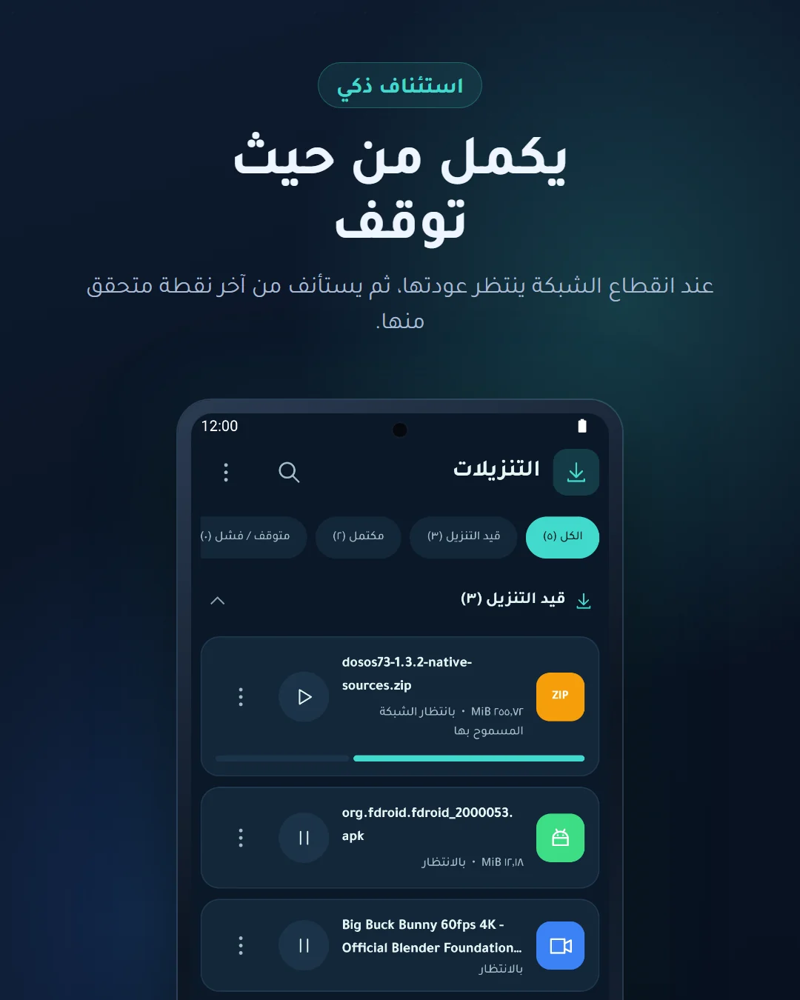
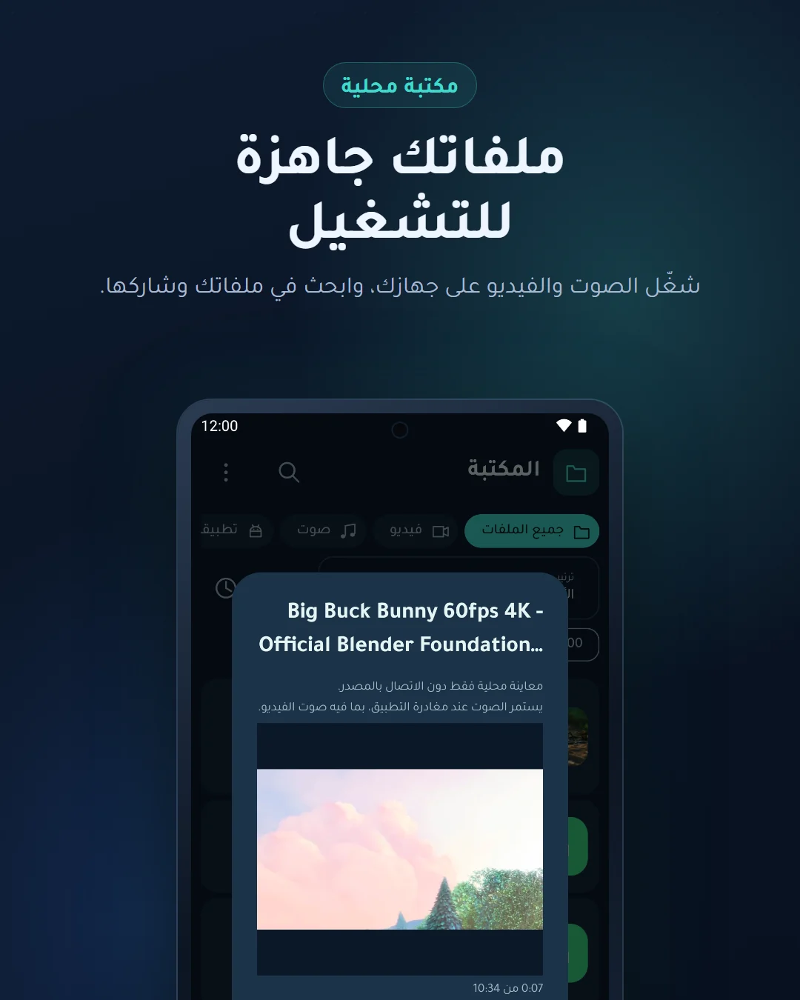
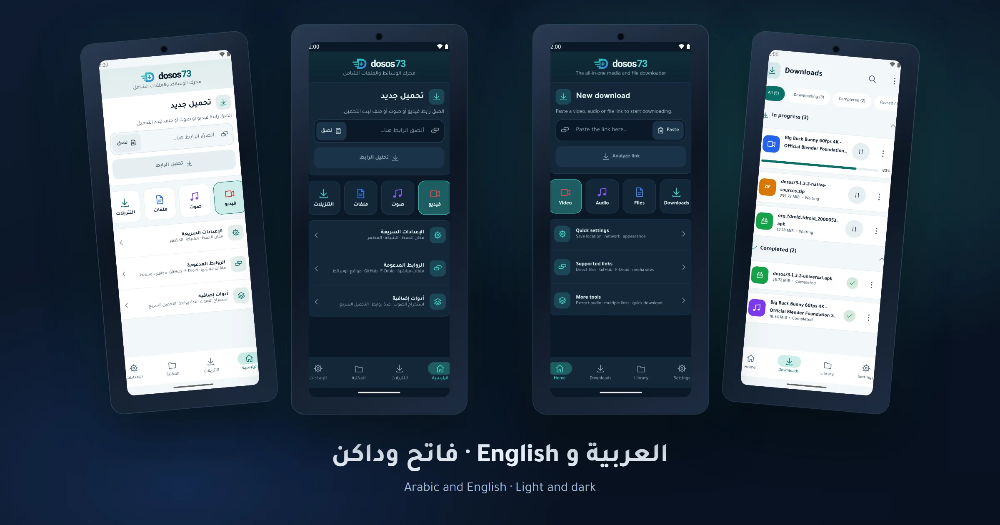

<div dir="rtl">

<div align="center">



# dosos73

**مدير تنزيل مفتوح المصدر لأندرويد: فيديو وصوت وملفات، بالعربية والإنجليزية.**

[**تنزيل dosos73 1.4.0**](https://github.com/taroq4-2/dosos73/releases/latest/download/dosos73.apk) · [الموقع الرسمي](https://taroq4-2.github.io/dosos73/) · [English](README.md) · [ملاحظات الإصدار](https://github.com/taroq4-2/dosos73/releases/tag/v1.4.0)


[](https://github.com/taroq4-2/dosos73/actions/workflows/android.yml)

</div>

يحوّل dosos73 الرابط إلى ملف متحقق منه على هاتفك. ألصق الرابط أو شاركه من تطبيق آخر، فيعرض لك ما يتيحه المصدر، فتختار الجودة والصيغة، وتتابع التنزيل حتى يُحفظ الملف. يعمل مع مواقع الوسائط، وروابط الملفات المباشرة، وإصدارات GitHub، وتطبيقات F-Droid. بلا إعلانات ولا حسابات ولا تتبّع.

## أبرز المزايا

<p align="center">



</p>
<p align="center">


</p>

- **حلّل قبل أن تنزّل.** يعرض الجودات والصيغ التي يتيحها المصدر، حتى 2160p للفيديو أو MP3 للصوت، مع الحجم المتوقع ومجلد الحفظ.
- **طابور واضح.** التقدم والسرعة والوقت المتبقي لكل ملف، مع إيقاف مؤقت واستئناف وإعادة ترتيب، وقائمة مستقلة للمكتمل وأخرى للمتوقف.
- **تحقق من المحتوى.** يتعرّف على نوع الملف من بايتاته الفعلية لا من اسمه، ويرفض صفحات الويب المتنكرة كملفات، ولا يثبّت أي APK تلقائيًا.
- **استئناف بعد الانقطاع.** إذا انقطعت الشبكة ينتظر عودتها ثم يكمل من آخر نقطة متحقق منها، حتى مع روابط GitHub الموقّعة.
- **مكتبة وتشغيل محلي.** شغّل الصوت والفيديو من جهازك، ويستمر الصوت في الخلفية. ابحث في ملفاتك ونظّمها وشاركها.
- **ودجت وإشعارات.** ودجت للشاشة الرئيسية يعرض التنزيل الحالي، وإشعارات تقدّم بأزرار إيقاف وإلغاء. أسماء الملفات مخفية ما لم تختر إظهارها.

<p align="center"></p>

## التنزيل

| الحزمة | الحجم | لمن |
|---|---:|---|
| [**الموحّدة**](https://github.com/taroq4-2/dosos73/releases/latest/download/dosos73.apk) (موصى بها) | 58.6 ميغابايت | كل أجهزة Android 10 فأحدث (ARM64 وARM32 وx86 وx86_64) |
| [ARM64](https://github.com/taroq4-2/dosos73/releases/download/v1.4.0/dosos73-1.4.0-arm64-v8a.apk) (تجريبية) | 22.3 ميغابايت | معظم الهواتف الحديثة. محرك الوسائط فيها لم يُجرَّب بعد على هاتف فعلي. |

الحزمتان موقّعتان بالمفتاح نفسه الذي وُقّع به 1.3.2، فتثبيت أيٍّ منهما يحدّث التطبيق الحالي ويحافظ على بياناتك. [التحقق ببصمة SHA-256](https://github.com/taroq4-2/dosos73/releases/download/v1.4.0/SHA256SUMS.txt)

إذا طلب Android ذلك، اسمح بالتثبيت من المتصفح أو مدير الملفات. أما dosos73 نفسه فلا يثبّت أبدًا ملفات APK التي ينزّلها.

## الجديد في 1.4.0

- تصميم جديد بالكامل للرئيسية والتنزيلات والمكتبة والإعدادات، مع سمة فاتحة ودعم للأجهزة اللوحية وتكبير الخط حتى 200%.
- ودجت للشاشة الرئيسية وإشعارات للتنزيل.
- روابط إصدارات GitHub وتطبيقات F-Droid تصل إلى الملف الصحيح عبر واجهاتها الرسمية.
- الملفات تُحفظ بأسماء مقروءة، والمكرر يأخذ رقمًا مميزًا بدل أن يحل محل غيره.
- التنزيل يصمد أمام فقد الاتصال، والمهام المنتظرة تعرض زر «استئناف».
- حزمة ARM64 اختيارية أصغر من الموحّدة بنحو 62%.

القائمة الكاملة: [CHANGELOG.md](CHANGELOG.md)

## الخصوصية والأمان

- سجلات المهام مشفّرة على الجهاز، والنسخ الاحتياطي للتطبيق معطّل. الملفات المحفوظة تبقى في المجلد الذي تختاره.
- لا تتلقى المصادر الخارجية إلا الطلبات اللازمة للتنزيل.
- لا يتجاوز dosos73 قيود DRM أو تسجيل الدخول أو القيود الإقليمية. نزّل فقط ما يحق لك حفظه.
- يرفض إعادة التوجيه إلى عناوين الشبكة الداخلية، ولا يخفض HTTPS أبدًا، وينظّف أسماء الملفات القادمة من الخوادم. [مراجعة الأمان](SECURITY_REVIEW.md) · [سياسة الخصوصية](PRIVACY.md)

## تقارير الجودة

| التقرير | ما يغطيه |
|---|---|
| [TEST_RESULTS.md](TEST_RESULTS.md) | اختبارات الوحدة وLint والجهاز، ومنها CI على GitHub من Android 10 إلى 16، وتجارب على شبكة حقيقية |
| [SECURITY_REVIEW.md](SECURITY_REVIEW.md) | الثغرات المكتشفة وإصلاحاتها، ومراجعة المكونات المُصدَّرة |
| [PERFORMANCE_AND_SIZE_REPORT.md](PERFORMANCE_AND_SIZE_REPORT.md) | أحجام الحزم، ومحاذاة صفحات 16 KB، وقياسات التشغيل |
| [UX_IMPLEMENTATION_REPORT.md](UX_IMPLEMENTATION_REPORT.md) | التصميم وفحوص الوصول والمقاسات |
| [ARCHITECTURE.md](ARCHITECTURE.md) | بنية التطبيق |
| [FINAL_REPORT.md](FINAL_REPORT.md) | جدول متطلبات 1.4.0، ومنه ما لم يُنجز بعد |

## البناء من المصدر

<div dir="ltr">

```sh
./gradlew testDebugUnitTest lintDebug lintRelease assembleDebug assembleRelease
```

</div>

استخدم JDK 17 أو 21 وAndroid SDK 36، وعلى Windows استخدم `gradlew.bat`. يبني Gradle الحزمة الأساسية، ويُضاف محرك الوسائط الأصلي بالأداة `tools/assemble_universal.py`. [تفاصيل التجميع](docs/COMPACT_ENGINE.md)

## الترخيص

شيفرة المشروع مرخّصة بـ **GPL-3.0-or-later**، وتحتفظ الاعتماديات والخطوط والرسوم بتراخيصها. تُنشر مصادر التطبيق والمكونات الأصلية مع كل إصدار.

[الترخيص](LICENSE) · [إشعارات الأطراف الثالثة](THIRD_PARTY_NOTICES.md) · [المساهمة](CONTRIBUTING.md) · [الإبلاغ عن مشكلة](https://github.com/taroq4-2/dosos73/issues/new/choose)

<sub>الصور من dosos73 1.4.0 على محاكي Android 15. الفيلم الظاهر هو *Big Buck Bunny* من مؤسسة Blender (ترخيص CC BY 3.0).</sub>

</div>
