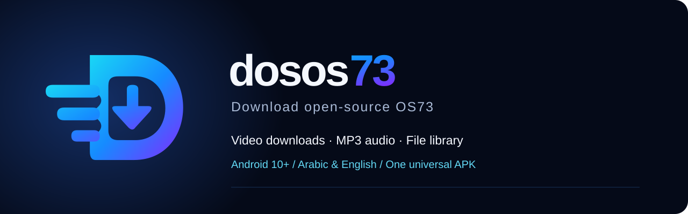
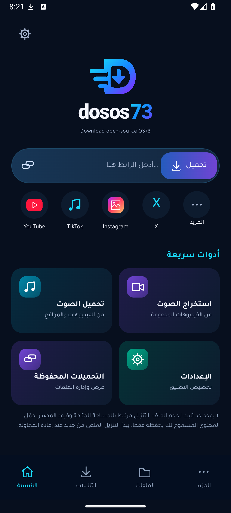
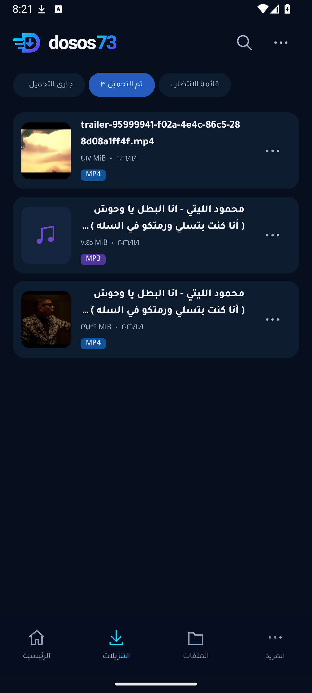
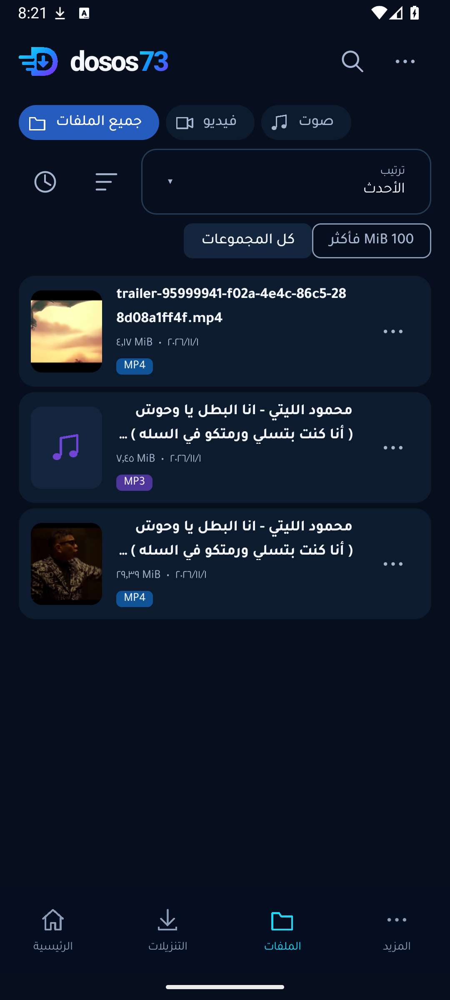
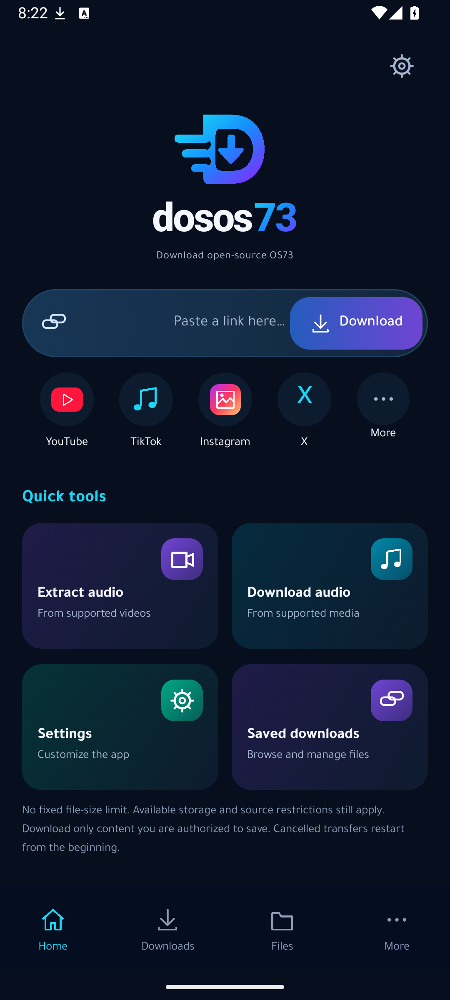
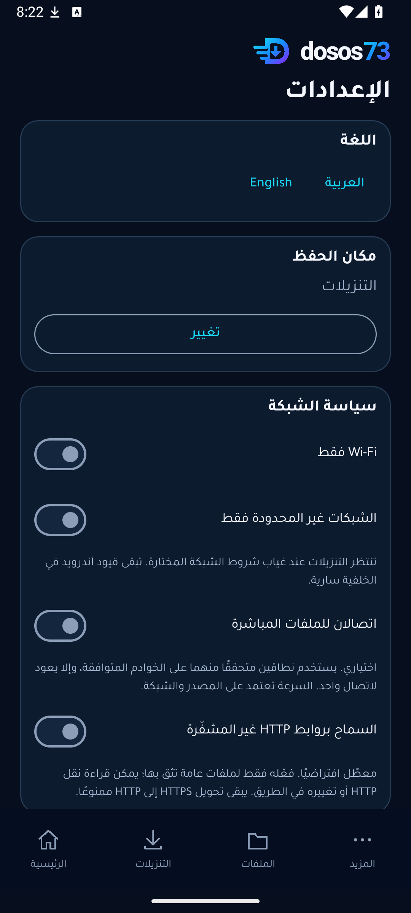

<div align="center">


# dosos73
### وسائطك، في مكان واحد.
مدير تنزيل مفتوح المصدر لأندرويد، مصمّم للعربية والإنجليزية.

[**تنزيل APK الموحّد**](https://github.com/taroq4-2/dosos73/releases/download/v1.2.0/dosos73-1.2.0-universal.apk) · [English](README.md) · [ملاحظات الإصدار](https://github.com/taroq4-2/dosos73/releases/tag/v1.2.0)


[](https://github.com/taroq4-2/dosos73/actions/workflows/android.yml)
</div>

## التنزيل

| الإصدار | حزمة واحدة لأجهزة أندرويد المدعومة |
|---|---|
| **1.2.0** | إصدار رسمي · أندرويد **10 فأحدث** |
| **62.06 MB** | ملف APK موحّد · ARM32 وARM64 وx86 وx86_64 |
| **MP3 V0** | تحويل صوت محلي · المحركات مضمّنة منذ التثبيت |

حجم الملف: **62,059,289 بايت**. لا تحتاج إلى اختيار نسخة خاصة بطراز هاتفك.

[تنزيل APK](https://github.com/taroq4-2/dosos73/releases/download/v1.2.0/dosos73-1.2.0-universal.apk) · [التحقق ببصمة SHA-256](https://github.com/taroq4-2/dosos73/releases/download/v1.2.0/SHA256SUMS.txt) · [نتائج الاختبار](docs/VERIFICATION.md)

ثبّت الحزمة، واسمح بالتثبيت من المتصفح أو مدير الملفات الذي اخترته عندما يطلب أندرويد ذلك. تحافظ التحديثات الرسمية على هوية التوقيع نفسها.

## تنزيلاتك اليومية

- **فيديو وMP3:** حلّل رابطًا عامًا، واختر جودة متاحة، ثم احفظ الفيديو المتوافق أو الصوت بصيغة MP3 V0.
- **ملفات مباشرة:** تنزيل متدفق دون حد ثابت للحجم داخل التطبيق، مع استئناف مشروط بتطابق المحتوى وخيار النقل باتصالين.
- **قائمة تنزيل محفوظة:** أولويات وإيقاف مؤقت واستئناف وإعادة محاولة، مع مراجعة دفعات تصل إلى 20 رابطًا واختيار الصيغة والمجلد لكل رابط.
- **حفظ متحقق منه:** بصمات للمحتوى، واسترداد للحفظ عند الانقطاع، وسجل مسبق لاسترداد عمليات إعادة التسمية المدعومة.
- **مكتبة ملفاتك:** بحث وتصفية ومجموعات ومعاينة ومشاركة، وحساب بصمة SHA-256 ومقارنتها عند الطلب.
- **انتظار هادئ:** إذا استمر انتظار الشبكة نحو 15 ثانية، تتوقف خدمة التنزيل. يمكن لأندرويد عرض تذكير بالاستئناف عندما تسمح شروط الشبكة والوقت المحدد؛ اضغط «استئناف» لفتح التطبيق والمتابعة.
- **العربية والإنجليزية:** تخطيط من اليمين إلى اليسار، وخط Tajawal، وواجهة داكنة بألوان السماوي والأزرق والبنفسجي.
- **دون حسابات أو إعلانات أو تحليلات استخدام.** تُقرأ الحافظة عندما تضغط «لصق».

## شاهد التطبيق

  

 

الصور ملتقطة من الإصدار الموقّع على محاكي أندرويد. [تفاصيل الالتقاط](screenshots/README.md).

## من الرابط إلى الملف

1. الصق الرابط أو شاركه من تطبيق آخر.
2. اختر نوع الوسائط والجودة المتاحة ومجلد الحفظ.
3. ابدأ التنزيل وتابع تقدمه.
4. افتح الملف أو شاركه أو تحقّق من بصمته من «الملفات».

لا يستطيع تحويل الصوت رفع جودة المصدر. قد يبدأ استخراج الوسائط من جديد بعد الانقطاع؛ الاستئناف بالبايتات مخصص للمصادر المباشرة المتوافقة التي يمكن التحقق من تطابق محتواها. تظل المساحة المتاحة وقيود المصدر مؤثرة. لا يتجاوز التطبيق المحتوى الخاص أو تسجيل الدخول أو DRM أو القيود الإقليمية.

## حزمة صغيرة، ومعالجة محلية

تحفظ الحزمة الموحّدة 642 ملف Python متطابقًا مرة واحدة، وتضم المحركات الأصلية للمعماريات الأربع في التنزيل نفسه. لا تحتاج المعالجة إلى خادم خارجي أو تنزيل مكتبات عند أول استخدام. يقلّل بناء الوسائط المضغوط بإصداراته المثبّتة، مع R8 وتقليص الموارد، حجم الحزمة. ترافق الإصدار بصمات المكونات الأصلية وتراخيصها.

## التحقق والمصدر

تتضمن [ملفات الإصدار](https://github.com/taroq4-2/dosos73/releases/tag/v1.2.0) حزمة APK موقّعة، وبصمات SHA-256، وقائمة مكونات بصيغة CycloneDX SBOM، ومصدر التطبيق، وأرشيفات مستقلة لمصادر المكونات الأصلية وإشعاراتها.

راجع [نتائج التحقق](docs/VERIFICATION.md) و[خريطة المشروع](docs/REPOSITORY_MAP.md) و[نتائج المراجعات ومعالجتها](docs/launch/REVIEW_DISPOSITIONS.md) لمعرفة نطاق الاختبارات والحدود المتبقية. دعم أندرويد 10 فأحدث لا يعني اختبار كل هاتف فعلي؛ ولا تعتمد نتائج المحاكي جميع الأجهزة أو مزوّدي التخزين أو الترميزات أو المواقع.

```sh
./gradlew testDebugUnitTest lintDebug lintRelease assembleDebug assembleRelease
```

استخدم JDK 17 أو 21 وAndroid SDK 35. على ويندوز استخدم `gradlew.bat`. يُنتج Gradle حزمة الأساس؛ اتبع [تجميع الحزمة الموحّدة](docs/COMPACT_ENGINE.md) لإنتاج الحزمة المضغوطة المختبرة. لا تضف مفاتيح التوقيع أو كلمات المرور إلى المستودع.

## الخصوصية والترخيص

سجلات المهام الخاصة مشفّرة على الجهاز، والنسخ الاحتياطي للتطبيق معطّل. تبقى الوسائط المحفوظة في الوجهة التي تختارها. تتلقى المصادر الخارجية طلبات الشبكة اللازمة للتنزيل.

الكود الأصلي مرخّص بموجب **GPL-3.0-or-later**. تحتفظ المكتبات والخطوط والأعمال الفنية المقدّمة من المالك بشروطها الخاصة. تتوفر المصادر والإشعارات بجانب حزمة APK.

[الترخيص](LICENSE) · [إشعارات المكونات](THIRD_PARTY_NOTICES.md) · [الخصوصية](PRIVACY.md) · [المساهمة](CONTRIBUTING.md) · [الإبلاغ عن مشكلة](https://github.com/taroq4-2/dosos73/issues/new/choose)