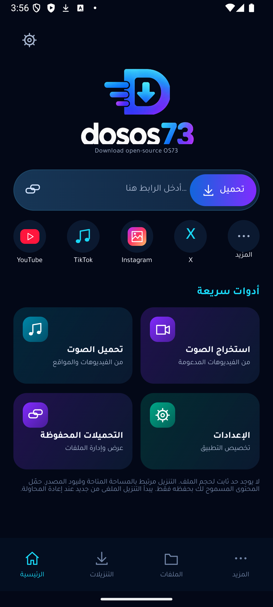
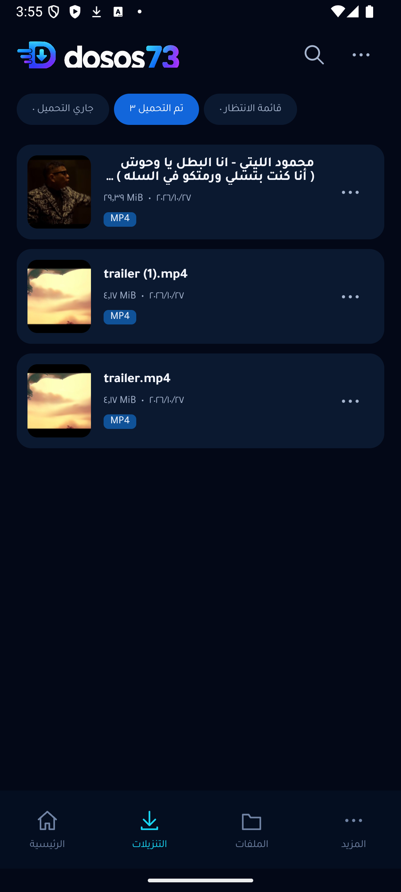
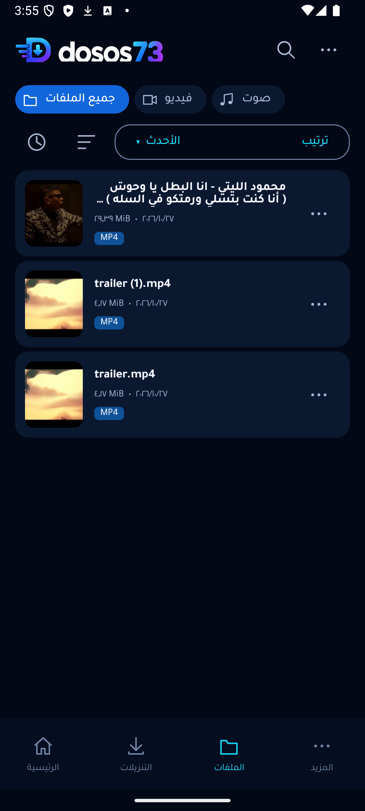
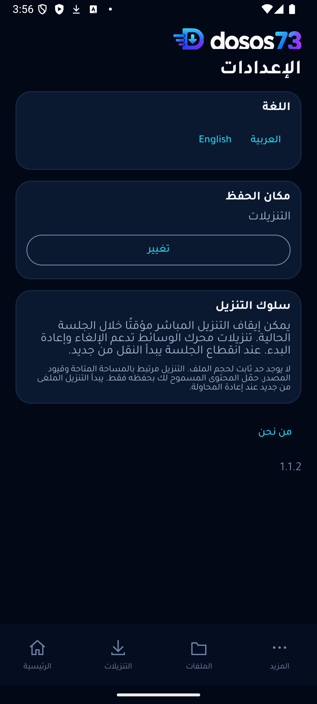
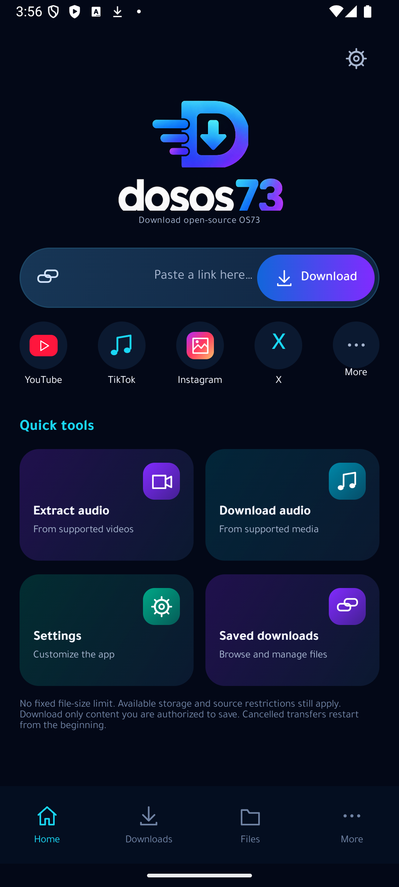

> فرع التطوير: **1.2.0-rc.1** يضيف استئناف الملفات المباشرة والاتصالين الاختياريين والدفعات والخصوصية وحزمة شاملة لأندرويد10 فأحدث. [الاختبارات والميزات والقيود المتبقية](docs/CHARTER_DELIVERY.md). يبقى رابط الإصدار المستقر أدناه1.1.2.

<div align="center">


# dosos73
**Download open-source OS73**

مدير تنزيلات مفتوح المصدر لأندرويد بواجهة عربية وإنجليزية.

[English](README.md) · [تحميل ARM64](https://github.com/taroq4-2/dosos73/releases/download/v1.1.2/dosos73-1.1.2-arm64-v8a.apk) · [جميع الإصدارات](https://github.com/taroq4-2/dosos73/releases) · [الموقع](https://os73.com)

[](https://github.com/taroq4-2/dosos73/actions/workflows/android.yml)
</div>

## التنزيل والتثبيت

**الإصدار 1.1.2 · Android 10 فأحدث · دون إعلانات أو حسابات.**

| النسخة | الجهاز |
|---|---|
| [ARM64 APK](https://github.com/taroq4-2/dosos73/releases/download/v1.1.2/dosos73-1.1.2-arm64-v8a.apk) | هواتف ARM64 الحديثة، ومنها Samsung S23 Ultra |
| [x86_64 APK](https://github.com/taroq4-2/dosos73/releases/download/v1.1.2/dosos73-1.1.2-x86_64.apk) | أجهزة Intel/AMD المتوافقة والمحاكيات |
| [بصمات الملفات](https://github.com/taroq4-2/dosos73/releases/download/v1.1.2/SHA256SUMS.txt) | SHA-256 للتحقق من ملفات APK المنشورة |

افتح APK واسمح بالتثبيت من المتصفح أو مدير الملفات الذي اخترته عند طلب أندرويد. تحمل التحديثات الرسمية شهادة التوقيع نفسها ويمكن تثبيتها فوق الإصدارات الرسمية السابقة دون مسح البيانات. النسخ التطويرية القديمة ذات توقيع Debug لا تقبل التحديث المباشر. اختر معمارية جهازك؛ أجهزة 32 بت غير مدعومة. لا يلزم تنزيل مكتبات المحرك عند لصق الرابط.

## المزايا

- لصق رابط عام واحد أو مشاركته، وتحليل الصيغ والجودات المتاحة فعليًا.
- تنزيل الفيديو والصوت والملفات المباشرة المدعومة، ودمج مسارات الصوت والفيديو المتوافقة.
- طابور متتابع وسجل فشل وإعادة محاولة، مع تقدم وسرعة وحجم حقيقي عند توفره.
- إيقاف مؤقت للتنزيل المباشر داخل الجلسة؛ إلغاء وإعادة بدء لتنزيلات المحرك.
- حفظ المهمة الجارية لاستعادتها بعد موت العملية، دون خدمة مراقبة مستمرة.
- مكتبة للبحث والتصفية والترتيب والصور المصغرة والفتح والمشاركة وإعادة التسمية والحذف المؤكد.
- حفظ في Downloads عبر MediaStore أو مجلد تمنحه للتطبيق، وفحص التخزين والناتج قبل النجاح.
- العربية RTL والإنجليزية LTR، واجهة كحلية وخط Tajawal وإعداد لغة لكل تطبيق.
- دون سقف ثابت لحجم الوسائط؛ تبقى المساحة والمهلات وقيود المصدر مؤثرة.

## صور التطبيق

صور فعلية من التطبيق الجاري؛ يحدد تقرير التحقق النسخة وبيئة التصوير. أدلة الإصدارات السابقة موضحة بصفتها التاريخية.

  

 

## الاستخدام

1. ألصق الرابط أو شاركه إلى dosos73.
2. انتظر التحليل واختر نوع الوسائط والجودة والصيغة.
3. ابدأ التنزيل وتابعه في صفحة التنزيلات.
4. افتح الملف المحفوظ بعد التحقق منه، من الإشعار أو المكتبة.

الاستعادة تبدأ النقل من البداية، وليست استكمالًا من آخر بايت. الإيقاف الإجباري من إعدادات أندرويد يمنع إعادة التشغيل حتى فتح التطبيق. يتوقف الطابور عند الفشل للمراجعة. الإزالة من السجل تختلف عن حذف الملف. حمّل فقط المحتوى الذي يحق لك حفظه.

## المواصفات

| الإعداد | القيمة |
|---|---|
| معرّف التطبيق | `com.os73.dosos73` |
| الإصدار / رقمه | `1.1.2` / `8` |
| الحد الأدنى / المستهدف / التجميع | SDK `29` / `35` / `35` |
| الواجهة | Kotlin 2.0.21، Jetpack Compose، Material 3 |
| الشبكة | OkHttp 4.12.0 وفحص العناوين العامة |
| محرك الوسائط | yt-dlp 2026.10.21 وEJS 0.8.0، الغلاف 0.18.1 |
| المعالجة | Python وQuickJS وFFmpeg مضمّنة |
| التوزيع | APK موقّعة لمعمارية ARM64 وأخرى x86_64 |

## البناء والاختبارات

استخدم JDK 17/21 وAndroid SDK platform/build-tools 35 وغلاف Gradle المرفق. اضبط مسار SDK محليًا ولا ترفع `local.properties`.

```sh
./gradlew testDebugUnitTest lintDebug lintRelease assembleDebug assembleRelease
./gradlew connectedDebugAndroidTest
./gradlew assembleRelease -PtargetAbi=arm64-v8a
./gradlew assembleRelease -PtargetAbi=x86_64
```

على Windows استخدم `gradlew.bat`. متغيرا `DOSOS73_KEYSTORE` و`DOSOS73_STORE_PASSWORD` مخصصان لبيئة التوقيع المعتمدة. غيابهما ينتج Release غير موقعة لا تُنشر كنسخة إنتاج. يشمل التحقق الآلي APIs 29 و33 و35 و36. اختبارات الشبكة الحية اختيارية منفصلة؛ نجاح اختبارات الوحدة لا يعني نجاح الشبكة. يجب اختبار ملف الإصدار المصغّر نفسه قبل نشره.

[التحقق وحدوده](docs/RELEASE_VALIDATION.md) · [البنية](docs/ARCHITECTURE.md) · [سجل التنظيف](docs/CLEANUP_MANIFEST.csv) · [التغييرات](CHANGELOG.md)

## الخصوصية والصلاحيات والحدود

لا تحليلات سلوكية أو إعلانات أو حسابات أو ملفات دخول أو إرسال رسائل تلقائي. تُقرأ الحافظة عند الضغط على اللصق فقط. تُخزّن روابط الطابور والسجل وبيانات الوجهة محليًا في مساحة التطبيق الخاصة، والنسخ الاحتياطي معطّل. ترى مواقع المصدر الطلبات وعنوان الشبكة. الصلاحيات للإنترنت ونقل البيانات بالخلفية والإشعارات الاختيارية؛ لا وصول شامل للملفات أو صلاحية وصول مساعد أو ظهور فوق التطبيقات. الملفات العامة عبر HTTP مدعومة، لذا تجنب الروابط الحساسة غير المشفرة.

قد تمنع قيود المواقع بعض التنزيلات. لا ضمان لدعم كل موقع، ولا تجاوز DRM أو قوائم تشغيل أو تحويل MP3 إلزامي أو استئناف دائم للبايتات. لا ندّعي اختبار هاتف Samsung فعلي أو إتمام تدقيق كل المكونات الأصلية وتوافق 16 KB. [الخصوصية](PRIVACY.md) · [الأمان](SECURITY.md) · [التحسينات الأمنية المتبقية](docs/SECURITY.md).

## المساهمة والترخيص

[دليل المساهمة](CONTRIBUTING.md) · [المشكلات](https://github.com/taroq4-2/dosos73/issues) · [المصدر](https://github.com/taroq4-2/dosos73)

الكود الأصلي تحت **GPL-3.0-or-later**؛ راجع [LICENSE](LICENSE). تبقى للاعتماديات والخطوط والشعار شروطها الخاصة؛ راجع [إشعارات الأطراف الأخرى](THIRD_PARTY_NOTICES.md). مراجعة تطابق المصادر والتراخيص لجميع المكونات الأصلية لم تكتمل.

### حول dosos73

**تحميل أسهل. تحكّم أكبر. مصدر مفتوح.**

dosos73 هو مدير تحميل مفتوح المصدر لنظام أندرويد، صُمّم لتوفير تجربة بسيطة وعملية لتحميل الفيديوهات والصوتيات وإدارة الملفات من مكان واحد.

نعمل على تطوير تطبيق يجمع بين سهولة الاستخدام والأداء الجيد، مع الاهتمام بالخصوصية والشفافية وإتاحة المجال للمجتمع للمساهمة في تطويره.

مشروع مفتوح، يتطور بمساهمات الجميع.

**مطور المشروع:** Tariq

**الموقع الرسمي:** [os73.com](https://os73.com)
