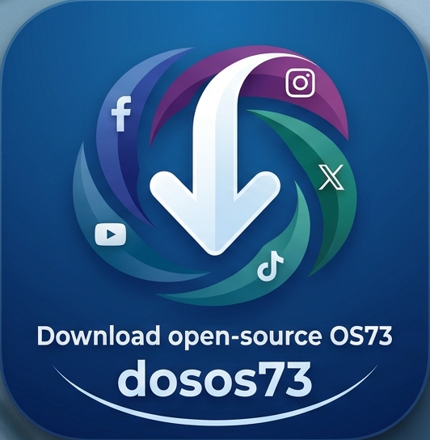
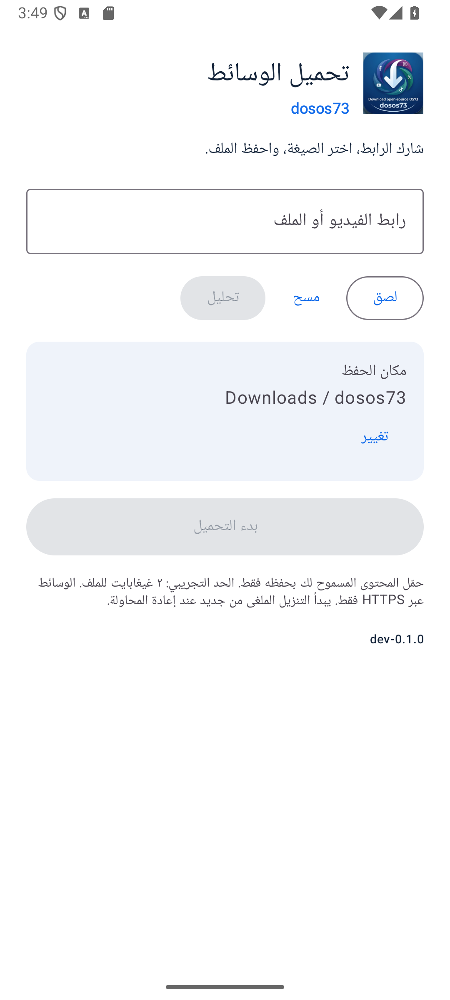
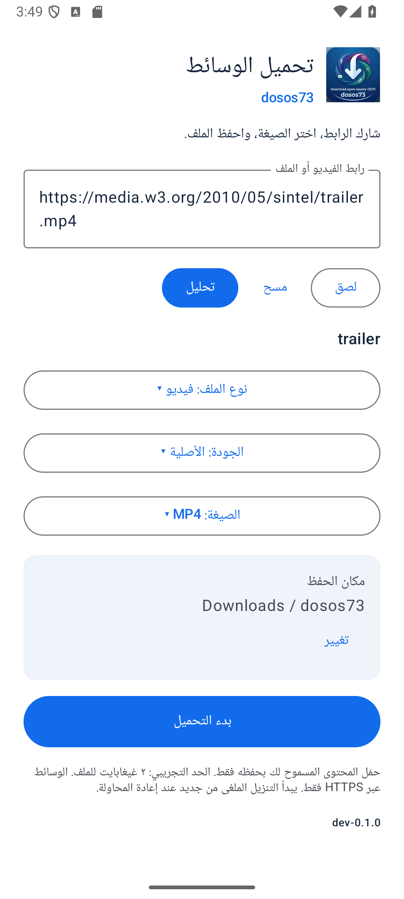
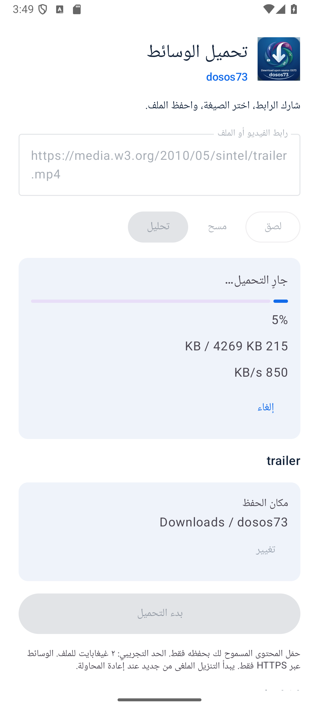
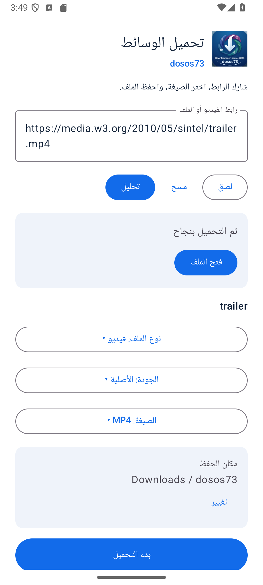

# Download open-source OS73 — dosos73



تطبيق أندرويد مفتوح المصدر بواجهة عربية وإنجليزية لتحليل الروابط وتنزيل الملفات والوسائط المتاحة.

**الحالة: 0.1.0-dev — إصدار تطوير، وليس إصدار 1.0 جاهزًا للإنتاج.** راجع [نتائج الاختبار](docs/TEST_RESULTS.md) و[المحددات](docs/COMPATIBILITY.md) قبل الاعتماد عليه.

## الاستخدام

1. شارك رابطًا نصيًا واحدًا مع التطبيق، أو الصقه ثم اختر «تحليل».
2. اختر النوع والجودة والصيغة من النتائج الفعلية.
3. اترك مكان الحفظ في Downloads/dosos73 أو اختر مجلدًا.
4. ابدأ التحميل. يمكنك الإلغاء ثم فتح الملف بعد اكتماله والتحقق منه.

لا حسابات أو إعلانات أو تحليلات أو مراقبة للحافظة. لا يبدأ التنزيل تلقائيًا عند المشاركة. لا تجاوز لحقوق الوصول أو DRM. حمّل المحتوى الذي تملك حق حفظه فقط.

## البناء

افتح المجلد في Android Studio. يلزم JDK 17 أو 21 وAndroid SDK 35.

```sh
./gradlew testDebugUnitTest lintDebug assembleDebug assembleRelease
./gradlew connectedDebugAndroidTest
```

Windows: استخدم `gradlew.bat`. يوجد APK التجريبي في `app/build/outputs/apk/debug/`. نسخة release غير موقعة حتى يضيف مالك المشروع إعداد توقيع آمنًا. لا توجد مفاتيح خاصة في المستودع.

## نطاق النسخة

- Android 10+، مع arm64-v8a وx86_64.
- تنزيل HTTP/HTTPS مباشر ببث محدود الذاكرة، وفحص الوجهات العامة والتحويلات.
- دمج yt-dlp وFFmpeg من مكتبة واحدة، وصيغ مأخوذة من المصدر، ودمج فيديو وصوت متوافقين.
- تخزين MediaStore أو المجلد الذي يصرح به المستخدم، مع إلغاء وحذف الملفات المؤقتة.
- حد تجريبي 2 GB. لا استئناف أو تحويل إلى صيغ إضافية في هذه النسخة.
- نتائج المنصات الاجتماعية غير مضمونة؛ لا تمثل رموز الشعار اعتمادًا أو شراكة.

## الوثائق

[البنية](docs/ARCHITECTURE.md) · [الاعتمادات](docs/DEPENDENCY_DECISIONS.md) · [الأمان](docs/SECURITY.md) · [التوافق](docs/COMPATIBILITY.md) · [الاختبارات](docs/TEST_RESULTS.md) · [الأداء](docs/PERFORMANCE.md) · [مراجعة الكود](docs/FINAL_CODE_AUDIT.md) · [مراجعات الجودة](docs/CODE_REVIEW.md)

## English

An Arabic-first, single-screen native Android downloader using Kotlin, Compose, scoped storage, streaming HTTP and an isolated yt-dlp adapter. This is a development preview, **not a verified production release**. Only source-available formats are displayed. Media requests use an HTTPS-only public-address proxy; direct transfers validate DNS and redirects. No authentication, telemetry, ads, background clipboard reading, browser, or player is included.

Build with JDK 17/21 and SDK 35 using the commands above. GitHub Actions builds debug/test-signed APKs and unsigned release APKs. Review the evidence and outstanding release blockers in `docs/`.

First-party code: GPL-3.0-or-later. Branding and third-party trademarks are excluded from that license grant; see [THIRD_PARTY_NOTICES.md](THIRD_PARTY_NOTICES.md).

## صور فعلية ونتائج الاختبار

 
 

نجح البناء المحلي واجتاز 14 اختبار JVM و5 اختبارات Android 15 تشمل تنزيلًا مباشرًا وتنزيل عينة عبر yt-dlp. هذه نسخة تطوير؛ دعم جميع المنصات والمراجعة الأمنية النهائية غير مكتملين.
