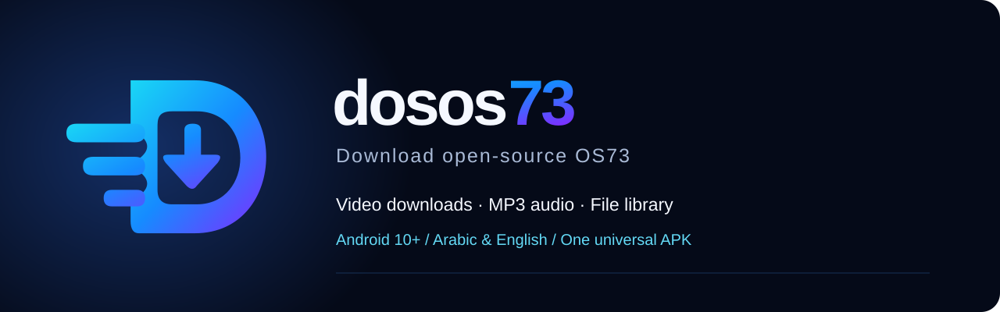
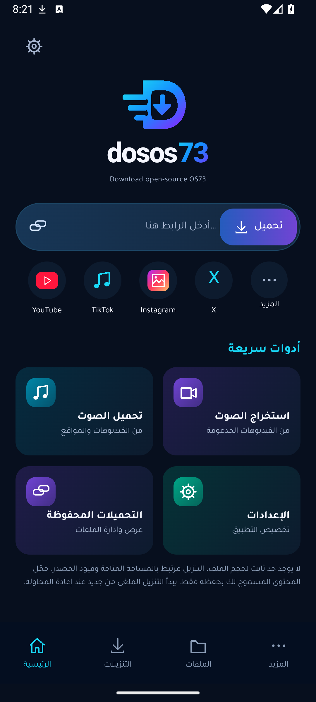
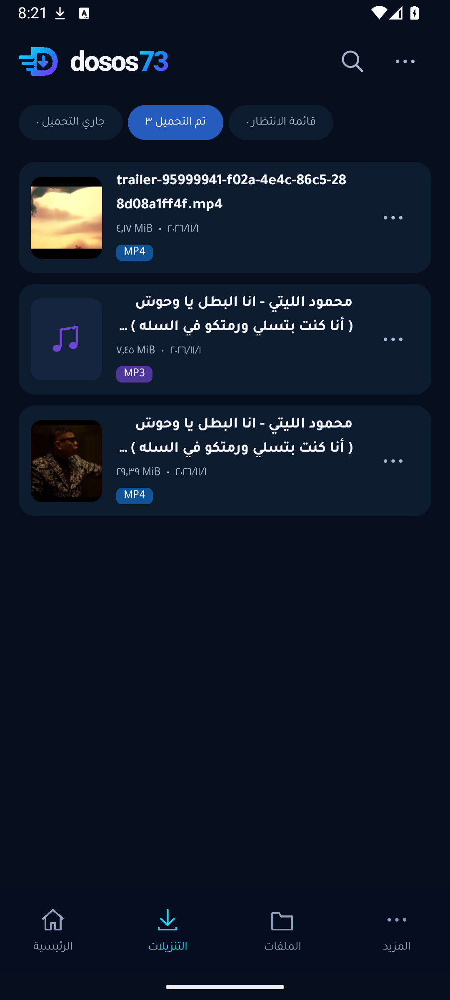
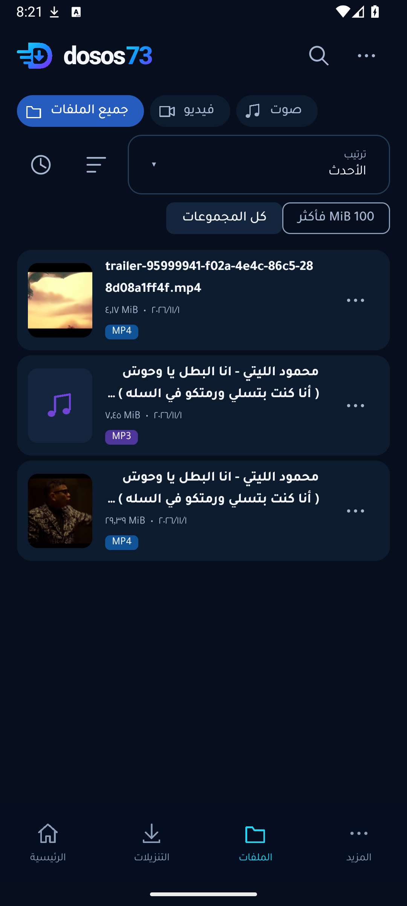
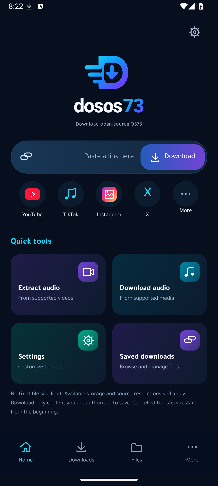
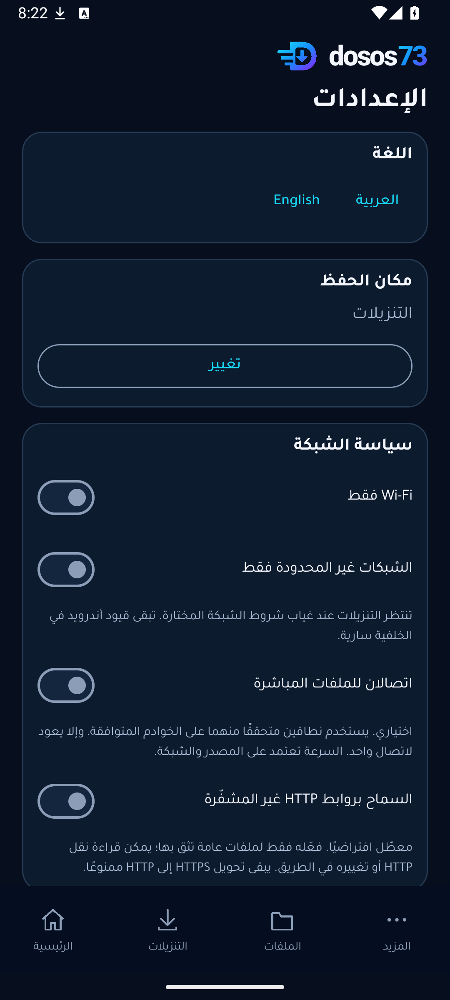

<div align="center">


# dosos73
### Your media. One place.
An open-source Android downloader, designed for Arabic and English.

[**Download the universal APK**](https://github.com/taroq4-2/dosos73/releases/download/v1.3.0/dosos73-1.3.0-universal.apk) · [العربية](README-ar.md) · [Release notes](https://github.com/taroq4-2/dosos73/releases/tag/v1.3.0)


[](https://github.com/taroq4-2/dosos73/actions/workflows/android.yml)
</div>

## Download

| Version | One package for supported Android devices |
|---|---|
| **1.3.0** | Official release · Android **10 and newer** |
| **60.78 MB** | One universal APK · ARM32, ARM64, x86 and x86_64 |
| **MP3 V0** | Local audio conversion · no first-use engine download |

[Download APK](https://github.com/taroq4-2/dosos73/releases/download/v1.3.0/dosos73-1.3.0-universal.apk) · [Verify SHA-256](https://github.com/taroq4-2/dosos73/releases/download/v1.3.0/SHA256SUMS.txt) · [Test results](docs/RELEASE_1_3_0.md)

Install the APK and allow installation from your chosen browser or file manager when Android asks. Updates keep the existing signing identity. No phone-specific edition is needed.

## Built for everyday downloads

- **Video and MP3:** analyze a public link, select an available quality, and save compatible video or MP3 V0 audio.
- **Direct files:** stream large files without a fixed app size limit, with validated byte-range resume and optional two-connection transfer.
- **A durable queue:** priorities, pause/resume, retry and a reviewable batch of up to 20 links with individual formats and folders.
- **Verified saving:** content fingerprints, recoverable publication and a write-ahead record for supported file renames.
- **Your file library:** search, filters, collections, preview, sharing and on-demand SHA-256 comparison.
- **Quiet when waiting:** after a bounded network wait the transfer service stops; Android can present a Resume reminder when network/time conditions allow it. Tap Resume to continue.
- **Arabic and English:** right-to-left layouts, Tajawal typography and a dark cyan/blue/violet identity.
- **No accounts, ads or analytics.** The optional Quick download entry reviews links before starting a transfer. Clipboard reads follow the consent settings documented in the privacy policy. [Privacy policy](PRIVACY.md)

## See the app

  

 

These screenshots show the signed 1.2.0 interface on an Android emulator. [Capture details](screenshots/README.md)

## From a link to a saved file

1. Paste a URL or share it from another app.
2. Choose media type, available quality and destination.
3. Start the download and follow its progress.
4. Open, share or verify the saved file from Files.

Audio conversion cannot improve the quality of the source. Native media extraction may restart after an interruption; verified byte-range resume is for compatible direct-file sources. Available space and source restrictions apply. Private/login-only content, DRM and regional restrictions are not bypassed.

## Small package, local processing

The universal APK stores 642 identical Python files once and keeps the ABI-specific native engines in the same download. No remote processing server or delayed library download is required. A pinned compact media build, R8 and resource shrinking reduce delivery size. Native component hashes and licenses accompany the release.

## Verification and source

The release includes a signed APK, SHA-256 checksums, a CycloneDX SBOM, application sources and a separate native source archive. [1.3.0 verification](docs/RELEASE_1_3_0.md) · [Architecture](docs/REPOSITORY_MAP.md)

```sh
./gradlew testDebugUnitTest lintDebug lintRelease assembleDebug assembleRelease
```

Use JDK 17 or 21 and Android SDK 36. On Windows, use `gradlew.bat`. Gradle builds the base APK. [Universal packaging](docs/COMPACT_ENGINE.md)

## Privacy and licensing

Private task records are encrypted on-device and app backup is disabled. Saved media remains in your selected destination. External sources receive the requests needed for downloads.

First-party code is **GPL-3.0-or-later**. Dependencies, fonts and owner-supplied artwork retain their own terms. Source and notice downloads are available beside the APK.

[License](LICENSE) · [Third-party notices](THIRD_PARTY_NOTICES.md) · [Privacy](PRIVACY.md) · [Contributing](CONTRIBUTING.md) · [Report a problem](https://github.com/taroq4-2/dosos73/issues/new/choose)
