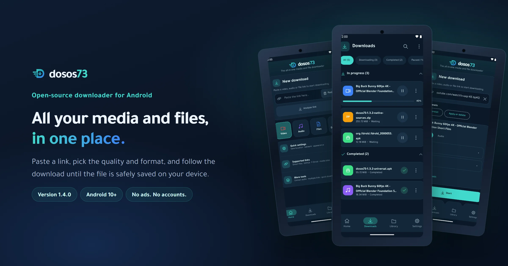
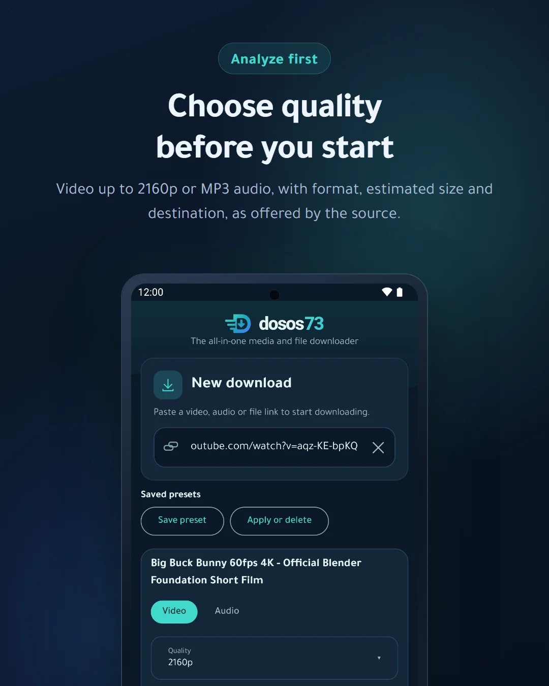
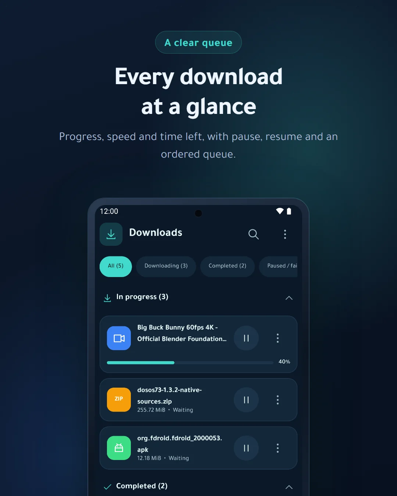
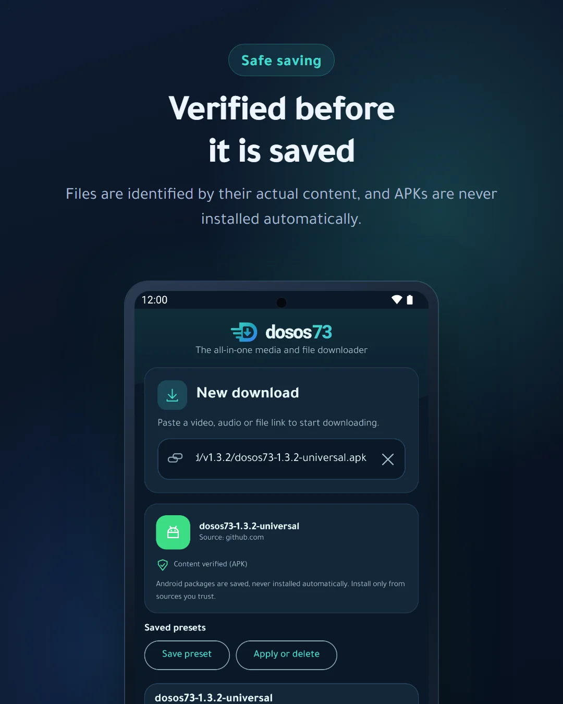
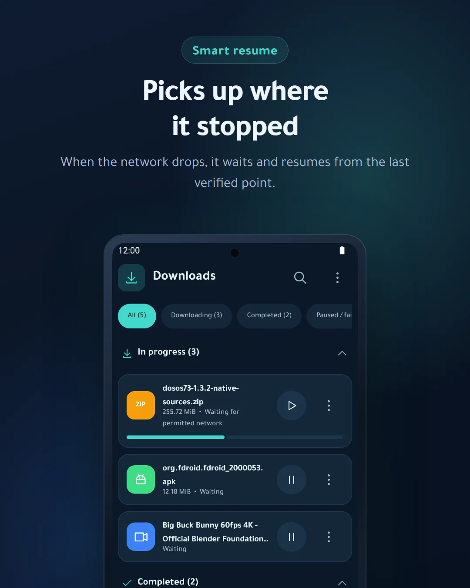
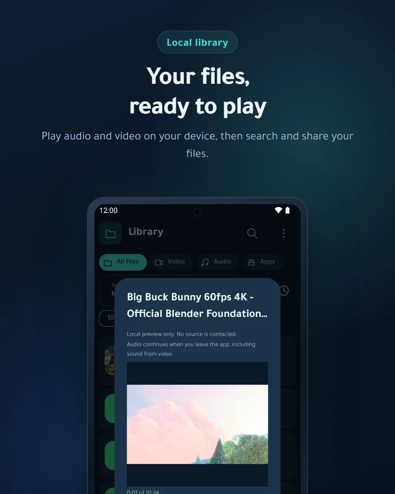
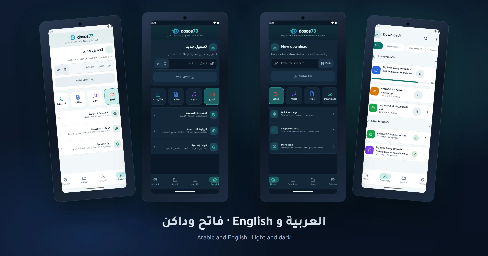

<div align="center">



# dosos73

**An open-source download manager for Android. Video, audio and files, in Arabic and English.**

[**Download dosos73 1.4.1**](https://github.com/taroq4-2/dosos73/releases/latest/download/dosos73.apk) · [Official site](https://taroq4-2.github.io/dosos73/en.html) · [العربية](README-ar.md) · [Release notes](https://github.com/taroq4-2/dosos73/releases/tag/v1.4.0)


[](https://github.com/taroq4-2/dosos73/actions/workflows/android.yml)

</div>

dosos73 turns a link into a verified file on your phone. Paste or share a link, see what the source offers, pick the quality and format, and follow the download until the file is saved. It works with media sites, direct file links, GitHub releases and F-Droid apps. It has no ads, no accounts and no analytics.

## Highlights

<p align="center">



</p>
<p align="center">


</p>

- **Analyze before you download.** See the qualities and formats the source offers, up to 2160p video or MP3 audio, with the estimated size and the destination folder.
- **A clear queue.** Progress, speed and time left for each file, with pause, resume and reordering. Finished and stopped items have their own lists.
- **Content verification.** Files are identified by their actual bytes, not their name. Web pages disguised as files are refused, and APKs are never installed automatically.
- **Resume after a drop.** When the network drops, the download waits and continues from the last verified point, including signed GitHub links.
- **Library and local playback.** Play audio and video from your device, with audio continuing in the background. Search, organize and share your files.
- **Widget and notifications.** A home-screen widget for the current download, and progress notifications with pause and cancel. File names stay hidden unless you choose to show them.

<p align="center"></p>

## Download

| Package | Size | For |
|---|---:|---|
| [**Universal**](https://github.com/taroq4-2/dosos73/releases/latest/download/dosos73.apk) (recommended) | 45.7 MB | Every Android 10+ phone, tablet and Chromebook (ARM64, ARM32, x86_64) |
| [ARM64](https://github.com/taroq4-2/dosos73/releases/download/v1.4.1/dosos73-1.4.1-arm64-v8a.apk) (experimental) | 21.9 MB | Most phones from the last several years |
| [ARMv7](https://github.com/taroq4-2/dosos73/releases/download/v1.4.1/dosos73-1.4.1-armeabi-v7a.apk) (experimental) | 20.5 MB | Older or entry-level 32-bit phones |
| [x86_64](https://github.com/taroq4-2/dosos73/releases/download/v1.4.1/dosos73-1.4.1-x86_64.apk) | 22.1 MB | Chromebooks, emulators and x86 tablets |

All packages are signed with the same key as 1.3.2, so installing one updates your existing app and keeps your data. The ARM-only packages are marked experimental because their media engine has not yet been tried on a physical phone. Since 1.4.1, 32-bit x86 devices are no longer supported. [Verify SHA-256](https://github.com/taroq4-2/dosos73/releases/download/v1.4.1/SHA256SUMS.txt)

When Android asks, allow installation from your browser or file manager. dosos73 itself never installs the APKs it downloads.

## What's new in 1.4.1

- Video and audio downloads start in about a second instead of about nine on our test emulator: the download reuses what the link analysis already found.
- The media engine starts about four times faster, and after an install or update it gets ready in the background.
- yt-dlp 2026.11.23 with the latest YouTube fixes.
- A package for each processor type, and a universal package 22% smaller (45.7 MB instead of 58.6 MB).
- Built with the current Android toolchain (Kotlin 2.4, AGP 9.5), which closes a build-tool security advisory.

## What's new in 1.4.0

- A complete redesign of Home, Downloads, Library and Settings, with a new light theme and support for tablets and text up to 200%.
- A home-screen widget and download notifications.
- GitHub release and F-Droid app links resolve to the right file through their official APIs.
- Files keep readable names, and a duplicate gets a distinguishing number instead of overwriting.
- Downloads survive a lost connection, and waiting items show a Resume button.
- An optional ARM64 package, about 62% smaller than the universal one.

Full list: [CHANGELOG.md](CHANGELOG.md)

## Privacy and safety

- Task records are encrypted on the device, and app backup is disabled. Saved files stay in the folder you choose.
- External sources only receive the requests needed to download.
- dosos73 does not bypass DRM, sign-in or regional restrictions. Download only what you are allowed to save.
- Redirects to internal network addresses are refused, HTTPS is never downgraded, and server file names are sanitized. [Security review](SECURITY_REVIEW.md) · [Privacy policy](PRIVACY.md)

## Quality reports

| Report | What it covers |
|---|---|
| [TEST_RESULTS.md](TEST_RESULTS.md) | Unit, lint and device tests, including GitHub CI on Android 10 to 16, and real-network trials |
| [SECURITY_REVIEW.md](SECURITY_REVIEW.md) | Findings, fixes and the exported-component review |
| [PERFORMANCE_AND_SIZE_REPORT.md](PERFORMANCE_AND_SIZE_REPORT.md) | Package sizes, 16 KB page alignment and startup measurements |
| [UX_IMPLEMENTATION_REPORT.md](UX_IMPLEMENTATION_REPORT.md) | The design, accessibility and layout checks |
| [ARCHITECTURE.md](ARCHITECTURE.md) | How the app is organized |
| [FINAL_REPORT.md](FINAL_REPORT.md) | The 1.4.0 requirements table, including what is not done yet |

## Build from source

```sh
./gradlew testDebugUnitTest lintDebug lintRelease assembleDebug assembleRelease
```

Use JDK 17 or 21 and Android SDK 36. On Windows, use `gradlew.bat`. Gradle builds the base APK; the native media runtime is packaged separately with `tools/assemble_universal.py`. [Packaging details](docs/COMPACT_ENGINE.md)

## License

First-party code is **GPL-3.0-or-later**. Dependencies, fonts and artwork keep their own terms. Application and native sources are published with each release.

[License](LICENSE) · [Third-party notices](THIRD_PARTY_NOTICES.md) · [Contributing](CONTRIBUTING.md) · [Report a problem](https://github.com/taroq4-2/dosos73/issues/new/choose)

<sub>Screenshots are from dosos73 1.4.0 on an Android 15 emulator. The film shown is *Big Buck Bunny* by the Blender Foundation (CC BY 3.0).</sub>
