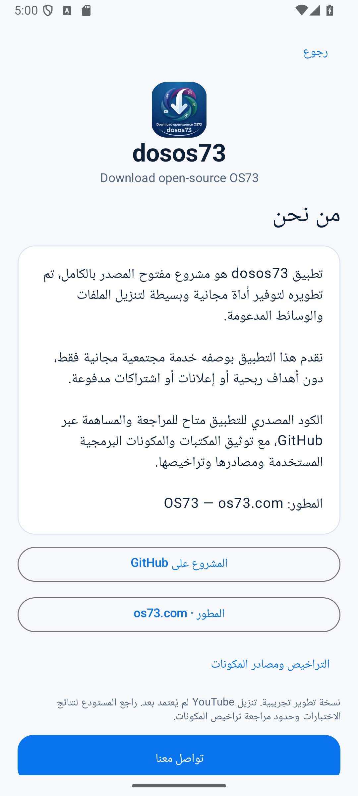
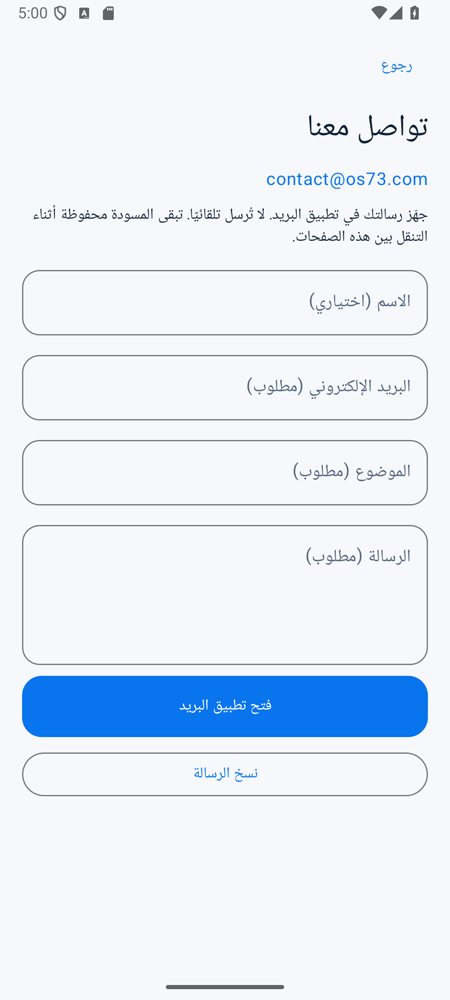

# dosos73 · Download open-source OS73

تطبيق أندرويد مفتوح المصدر لتحميل الملفات والوسائط المدعومة، بواجهة عربية وإنجليزية.

**0.2.0-preview — نسخة تجريبية موقّعة بمفتاح Android Debug، وليست إصدارًا إنتاجيًا. تنزيل YouTube لم يُعتمد بعد.** ظهر رفض HTTP403 وطلب تحقق، كما ظهر خطأ TLS متقطع في اختبار محرك الوسائط. راجع [تقرير التحقيق](docs/YOUTUBE_DOWNLOAD_ROOT_CAUSE.md).

[صفحة الإصدار](https://github.com/taroq4-2/dosos73/releases/tag/v0.2.0-preview) · [تحميل APK التجريبي](https://github.com/taroq4-2/dosos73/releases/download/v0.2.0-preview/dosos73-0.2.0-preview-debug.apk) · [التحقق SHA256](https://github.com/taroq4-2/dosos73/releases/download/v0.2.0-preview/SHA256SUMS.txt)

## ما تغير

- أزيل سقف 2 GiB من التنزيل المباشر ومحرك الوسائط والتحقق النهائي. لا يوجد حد ثابت لحجم الملف؛ تظل المساحة المتاحة وقيود النظام والمصدر سارية.
- واجهة فاتحة: أزرار فيديو وصوت، بطاقات الجودة والصيغة والحفظ، تقدم فعلي، وبطاقة نجاح خضراء.
- صفحتا «من نحن» و«تواصل معنا». نموذج التواصل يفتح مسودة إلى contact@os73.com أو ينسخها؛ لا يرسل بريدًا تلقائيًا.
- محرك yt-dlp 2026.10.21 وEJS 0.8.0 مثبتان مع التحقق من البصمة؛ رسائل خاصة برفض المصدر وTLS وامتلاء التخزين.
- تحقّق من الصوت والدقة، ومن الملف المنسوخ قبل إظهاره مكتملًا.

## الاستخدام

1. شارك رابطًا نصيًا مع التطبيق، أو الصقه واختر «تحليل».
2. اختر جودة وصيغة من الخيارات التي يعيدها المصدر فعلًا. الخيارات غير المتاحة معطّلة.
3. اختر Downloads/dosos73 أو مجلدًا آخر.
4. ابدأ التنزيل ثم افتح الملف بعد اكتماله والتحقق منه.

يحتاج التنزيل إلى مساحة للملفات المؤقتة والنسخة النهائية، وقد يحتاج الدمج مساحة إضافية. لا يوجد استئناف؛ الإلغاء ثم إعادة المحاولة يبدأ من جديد. لا يوجد تحويل MP3 إضافي ما لم يوفر المصدر هذه الصيغة. لا يضمن توفر عنوان الفيديو إمكانية تنزيله.

لا حسابات أو إعلانات أو تحليلات أو مراقبة للحافظة. لا تجاوز لقيود الوصول أو DRM. حمّل ما تملك حق حفظه فقط.

## صور من التطبيق الفعلي

الصور من محاكي Android 15، والتنزيل المصوّر لعينة فيديو عامة مباشرة، **وليس إثباتًا لنجاح YouTube**.

 
 
 

## الاختبارات والوثائق

[نتائج V4](docs/V4_TEST_RESULTS.md) · [مراجعات الجودة العشرون](docs/V4_REVIEW_MATRIX.md) · [مراجعة الكود](docs/FINAL_CODE_AUDIT.md) · [الأمان](docs/SECURITY.md) · [الأداء](docs/PERFORMANCE.md) · [التراخيص](THIRD_PARTY_NOTICES.md)

اختبارات الحجم تستخدم طول استجابة معلنًا وملفًا sparse؛ لا تمثل تنزيلًا فعليًا متعدد الغيغابايت. اختبارات CI على Android 15 و16 منفصلة عن اختبارات الإنترنت. لا توجد موافقة إصدار مستقر أو مراجعة مستقلة مكتملة.

## البناء

Android Studio، JDK 17 أو 21، Android SDK 35. minSdk 29، targetSdk/compileSdk 35، مع arm64-v8a وx86_64.

~~~sh
./gradlew testDebugUnitTest lintDebug assembleDebug assembleRelease
./gradlew connectedDebugAndroidTest
~~~

على Windows استخدم gradlew.bat. حزمة debug قابلة للتثبيت بمفتاح اختبار؛ حزمة release المحلية غير موقعة. لا توجد مفاتيح إنتاج أو بيانات دخول في المستودع.

## English

A native Kotlin/Compose Android downloader with Arabic/English UI, scoped storage and streaming transfers. Version 0.2.0-preview removes the fixed media-size ceiling, adds the light UI, About and mail-composer contact flow, and improves stage-specific diagnostics. Storage capacity, provider limits and Android execution limits still apply.

**YouTube is NOT verified fixed.** The development APK is Android Debug-signed, not production-signed. Deterministic CI covers API35/API36; network tests and documented failures are separate. No fake progress, unsupported pause/resume, automatic email sending, credential collection or authentication bypass.

First-party code: GPL-3.0-or-later. Branding and third-party components have separate terms; see the notices and outstanding native audit limitations. Developer: [OS73](https://os73.com).

