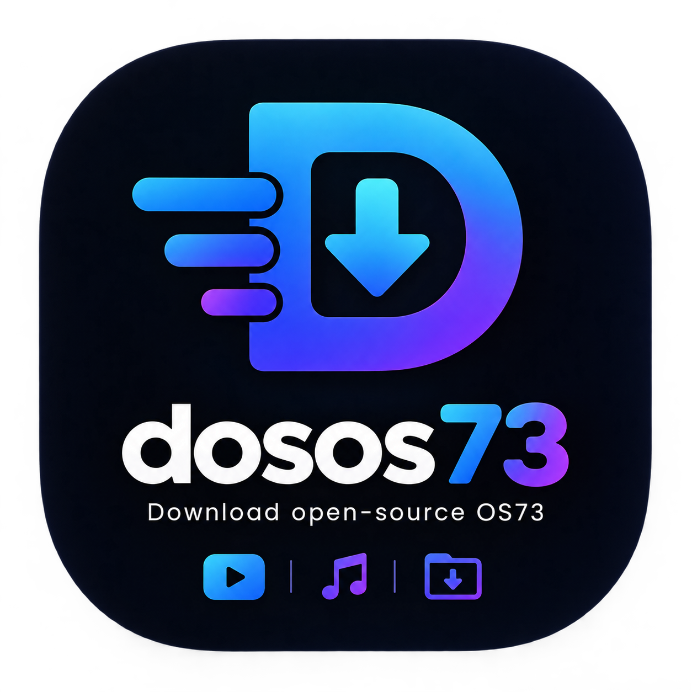
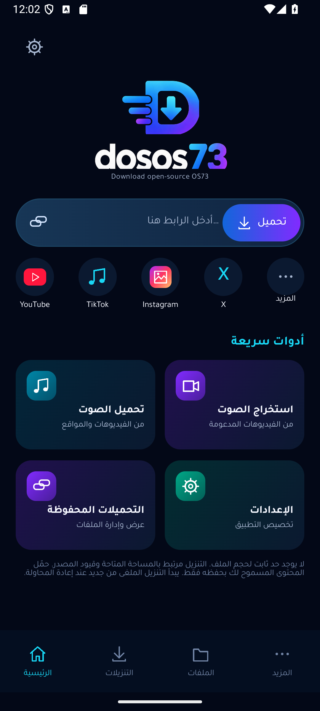
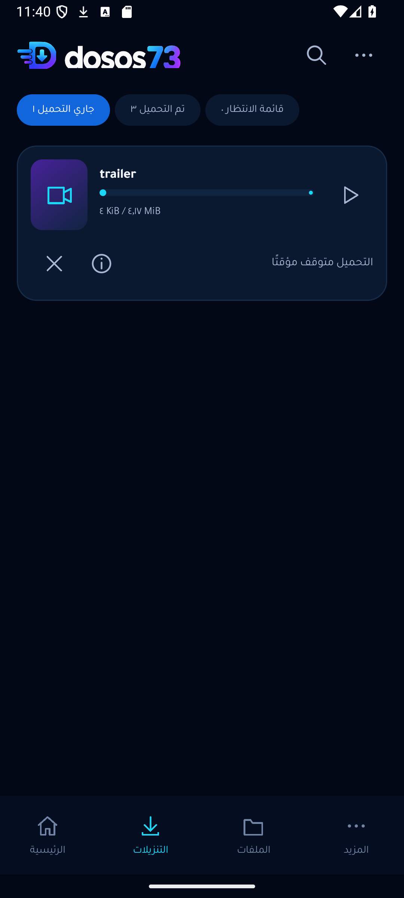
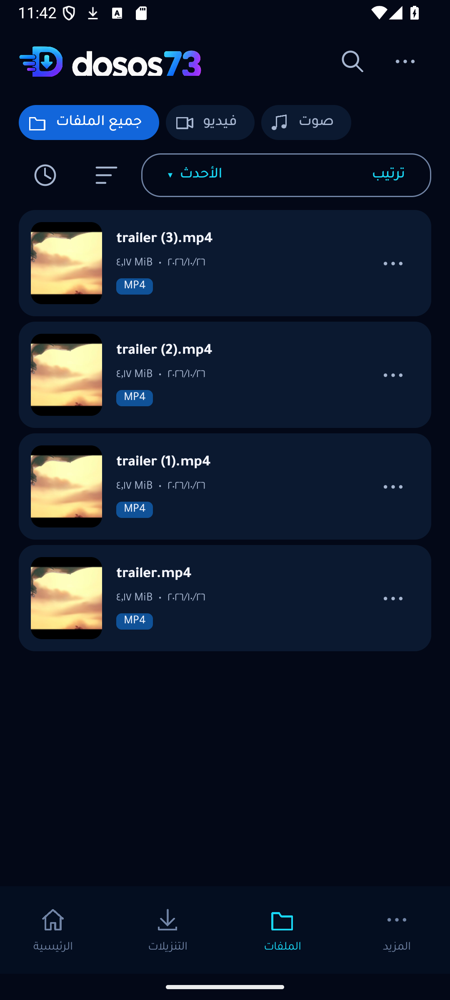
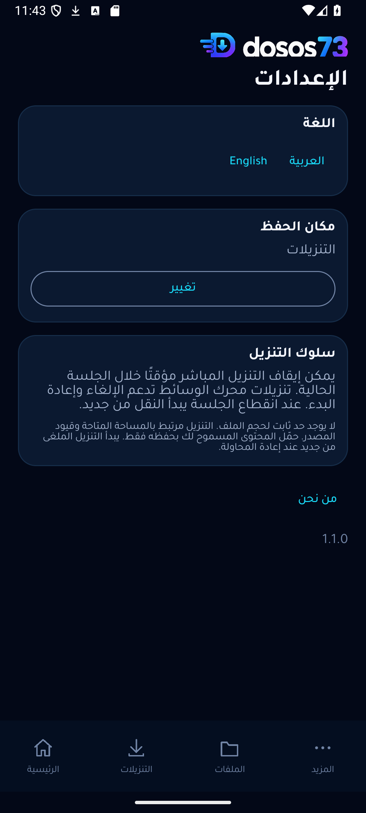
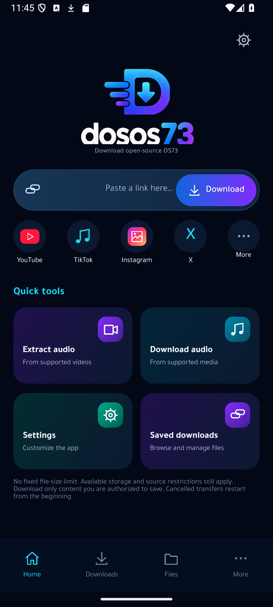
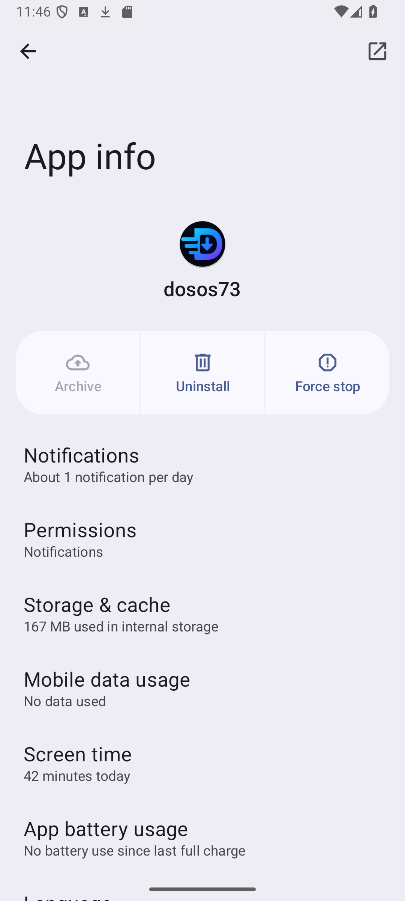

# dosos73

### Download open-source OS73



مدير تنزيلات مفتوح المصدر لأندرويد بواجهة عربية وإنجليزية، وهوية كحلية بتدرجات السماوي والأزرق والبنفسجي. نزّل الوسائط المدعومة، تابع المهام، وأدر ملفاتك من مكان واحد.

[**تنزيل dosos73 1.1.1 للهاتف — ARM64 APK، نحو 59 MB**](https://github.com/taroq4-2/dosos73/releases/download/v1.1.1/dosos73-1.1.1-arm64-v8a.apk) · [نسخة x86_64](https://github.com/taroq4-2/dosos73/releases/download/v1.1.1/dosos73-1.1.1-x86_64.apk) · [تفاصيل الإصدار](https://github.com/taroq4-2/dosos73/releases/tag/v1.1.1) · [SHA256](https://github.com/taroq4-2/dosos73/releases/download/v1.1.1/SHA256SUMS.txt)

يتطلب **Android 10 أو أحدث**. اختر ARM64 للهواتف الحديثة مثل Samsung S23 Ultra؛ نسخة x86_64 منفصلة للأجهزة المتوافقة والمحاكيات. انخفض حجم نسخة الهاتف بنحو **47%** مقارنة بحزمة 1.1.0، دون تنزيل مكتبات إضافية عند اللصق. تستخدم النسخة مفتاح الإصدار السابق نفسه وتُثبّت فوقه دون حذف التطبيق. [تقرير إصلاح الانهيار والحجم والاستعادة](docs/RELIABILITY_1.1.1.md).

## داخل التطبيق

- رئيسية لإدخال الرابط وتحليل الصيغ والجودات المتاحة فعليًا.
- شاشة تنزيلات بتقدم وسرعة وحجم حقيقيين، وقائمة انتظار محفوظة تعمل بالتتابع.
- الاحتفاظ بالمهمات الفاشلة والملغاة لإعادة المحاولة. يتوقف الطابور عند الفشل حتى يختار المستخدم المتابعة.
- إيقاف مؤقت واستئناف للتنزيل المباشر داخل الجلسة الحالية؛ تنزيلات محرك الوسائط تدعم الإلغاء وإعادة البدء.
- مكتبة لملفات التطبيق، مع البحث والتصفية والترتيب والصور المصغرة والفتح والمشاركة وإعادة التسمية والحذف المؤكد.
- الإزالة من سجل التنزيلات منفصلة عن حذف الملف نفسه.
- اختيار مجلد الحفظ، وصفحات الإعدادات والتعريف والتواصل، ودعم العربية RTL والإنجليزية LTR.
- تحميل بلا سقف ثابت لحجم الملف، مع فحص المساحة والتحقق من سلامة الناتج قبل إعلان الاكتمال.
- دون إعلانات أو حسابات أو تحليلات سلوكية أو مراقبة للحافظة.

## صور فعلية

صور من التطبيق الجاري على Android 15؛ الملفات الظاهرة عينات عامة استُخدمت للاختبار. حالة التوقف والطابور ناتجة عن تنزيل حقيقي، والأعداد غير ثابتة.

  

  

[صور الواجهة السابقة](screenshots/01-main-ar.png) · [تقرير التصميم والتحقق](docs/NEON_REDESIGN.md)

[صورة اكتمال تنزيل YouTube من الإصدار 1.1.1](screenshots/youtube-completed-1.1.1.png) · [نتائج الإصلاح والاستعادة وتقليل الحجم](docs/RELIABILITY_1.1.1.md)

## الاستخدام

1. ألصق رابطًا أو شاركه من تطبيق آخر.
2. اضغط «تحميل» لتحليل المصدر، ثم اختر نوع الوسائط والجودة والصيغة.
3. اضغط «ابدأ»؛ تتولى شاشة التنزيلات متابعة المهمة والطابور.
4. افتح الملف بعد اكتماله من الإشعار أو المكتبة.

تُحفظ المهمة الجارية لاستعادتها إذا أعاد أندرويد تشغيل الخدمة أو عند فتح التطبيق بعد انقطاع العملية؛ تعاد المحاولة من بداية الملف، وليس من آخر بايت. «إيقاف إجباري» من إعدادات الهاتف يمنع إعادة التشغيل حتى فتح التطبيق. لا تعمل خدمة مراقبة مستمرة عند الخمول. قد تمنع قيود المصدر أو الشبكة بعض الروابط. لا يستورد التطبيق بيانات تسجيل الدخول أو يتجاوز DRM. إزالة عنصر من السجل لا تحذف ملفه؛ حذف الملف يتطلب تأكيدًا.

## التطوير والتحقق

Kotlin وJetpack Compose؛ minSdk 29 وtargetSdk 35؛ JDK 17/21 وAndroid SDK 35. لا توجد مفاتيح أو كلمات مرور في المستودع.

```sh
./gradlew testDebugUnitTest lintDebug assembleDebug assembleRelease
./gradlew connectedDebugAndroidTest
./gradlew assembleRelease -PtargetAbi=arm64-v8a
./gradlew assembleRelease -PtargetAbi=x86_64
```

على Windows استخدم `gradlew.bat`. الترجمتان تخضعان لفحص تطابق المفاتيح أثناء البناء. اختبارات الوحدة تستخدم خادمًا محليًا داخل الاختبار؛ اختبارات الشبكة العامة منفصلة وتتطلب التفعيل. للتوقيع اضبط `DOSOS73_KEYSTORE` و`DOSOS73_STORE_PASSWORD` في بيئة البناء. المصدر المثبت لمحرك الوسائط موجود في المستودع؛ لم يُستبدل ضمن إعادة التصميم.

[نتائج إعادة التصميم](docs/NEON_REDESIGN.md) · [مراجعة الإصلاحات السابقة](docs/REVIEW_1.0.1.md) · [الأمان والحدود المعروفة](docs/SECURITY.md) · [التراخيص والمكونات](THIRD_PARTY_NOTICES.md)

## English

dosos73 is an open-source native Android media downloader with Arabic/English UI, a navy neon visual system, a durable sequential queue, retryable failures and an app-owned file library. File actions use Android scoped storage. Direct transfers support cooperative pause/resume within the current session; media-engine transfers support cancel/restart. Process-death resume is not implemented. Source availability and storage capacity still apply.

Version 1.1.0 retains the official release signing key. Download and verification links are above. See the redesign report for executed tests and remaining limitations.

First-party code: **GPL-3.0-or-later**. Dependencies, fonts and supplied branding retain their own terms. Developer: [OS73](https://os73.com) · contact@os73.com.
