# UX_IMPLEMENTATION_REPORT — dosos73 vNext (المرحلة D)

المرجع البصري: [`docs/vnext/screens/reference.png`](docs/vnext/screens/reference.png) (الهواتف الثلاثة: الرئيسية، التنزيلات، الودجت). كل اللقطات أدناه **لقطات حقيقية** من التطبيق على المحاكي `dosos73_vnext` (Android 15، 1080×2400، 420dpi)، ببيانات تنزيل حقيقية من إصدار `v1.3.2` على GitHub. لا توجد صور تصميم مستقلة ولا أرقام مصطنعة.

> الودجت (الهاتف الأيمن في المرجع) نُفّذ في المرحلة E، وتجده في القسم 7.

## 1) الهوية والتوكنات

| التوكن (المرجع) | الوضع الداكن | الوضع الفاتح | المصدر |
|---|---|---|---|
| خلفية كحلية | `#0B1929` | `#F2F7F9` | `DososPalettes` في `DesignSystem.kt` |
| سطح البطاقات | `#14273A` | `#FFFFFF` | ″ |
| الفيروزي التفاعلي | `#42D9CC` (نص الزر `#04201F`) | `#0A7068` (نص الزر أبيض) | ″ |
| النص الفاتح | `#E4F5F4` | `#0B1929` | ″ |
| ألوان الأنواع | فيديو أزرق، صوت بنفسجي، PDF أحمر، ZIP برتقالي، APK أخضر، صور وردي | نفس الدلالة بدرجات أغمق | ″ |

- **لا ألوان مبعثرة:** كل الشاشات تقرأ اللوحة النشطة عبر `LocalPalette`، والأسماء القديمة (`Neon.*`) صارت تشير إليها، فتبنّت كل الشاشات القديمة اللوحة الجديدة والوضع الفاتح تلقائيًا.
- **التباين:** يتحقق `DesignContrastTest` من نسبة ≥ 4.5:1 لكل نص على كل سطح، و≥ 3:1 للأيقونات والعناصر التفاعلية، في الوضعين. الاختبار **PASSED**.
- **السمة:** حسب النظام / داكن / فاتح، وألوان الخلفية (Material You) خيار اختياري على Android 12 فأحدث. الافتراضي داكن، مطابقًا للمرجع. يتغير لون أيقونات شريط الحالة مع السمة.
- **الزوايا:** 12–20dp حسب المكوّن (بطاقات 18dp، أزرار 16dp، شرائح الفلاتر دائرية).
- **الأيقونات:** مرسومة متجهيًا داخل التطبيق دون مكتبة أيقونات أو صور. أُضيفت 17 أيقونة جديدة، وتنعكس أيقونتا الرجوع والسهم تلقائيًا في RTL.
- **الخط:** Tajawal (مرخص، مضمّن من 1.3.2).

## 2) مطابقة الشاشات

### الرئيسية — الهاتف الأيسر

| عنصر المرجع | التنفيذ | الحالة |
|---|---|---|
| رأس dosos73 + «محرك الوسائط والملفات الشامل» + موجة | شعار المشروع + الشعار النصي + سطر تعريف + موجة مرسومة | مطابق |
| زر القائمة (☰) والتاج 👑 | **لم يُنفّذا**: لا توجد وظيفة حقيقية وراءهما، والمواصفة تمنع الأزرار الشكلية | استبعاد مقصود |
| بطاقة «تحميل جديد» + الوصف | `HomeScreen.kt` | مطابق |
| حقل الرابط مع زر «لصق» داخله | `OutlinedTextField` + زر «لصق» يتحول إلى «مسح» بعد الكتابة | مطابق |
| زر «تحليل الرابط» الفيروزي | معطّل بلون محايد حين يكون الحقل فارغًا (حالة صادقة) | مطابق مع حالة تعطيل |
| فيديو / صوت / ملف / التنزيلات | فيديو وصوت يحددان الصيغة المفضلة (مع حالة اختيار ظاهرة)، «ملفات» يفتح المكتبة، «التنزيلات» يفتح التنزيلات | مطابق، وكل زر يؤدي فعلًا حقيقيًا |
| الإعدادات السريعة / الروابط المدعومة / أدوات إضافية | تفتح الإعدادات، وصفحة دعم صادقة تتضمن قسم «غير مدعوم»، وصفحة الأدوات | مطابق |
| شريط سفلي بأربعة أقسام، الرئيسية يمينًا | `AppNavigation.kt` يتبع اتجاه اللغة (كان مجبرًا على LTR في 1.3.2) | مطابق |

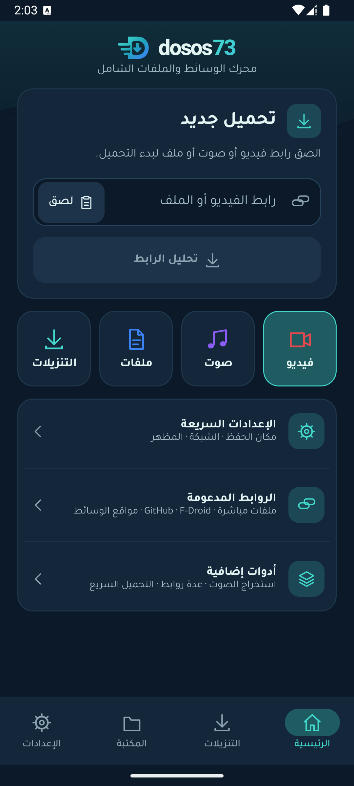

### التنزيلات — الهاتف الأوسط

| عنصر المرجع | التنفيذ | الحالة |
|---|---|---|
| عنوان + أيقونة + بحث + قائمة | `ScreenHeader` | مطابق |
| فلاتر بأعداد (الكل، قيد التنزيل، مكتمل، متوقف) | أعداد مشتقة من `DownloadBoard`، والأقسام تطابق الفلاتر | مطابق |
| أقسام قابلة للطي | «قيد التنزيل» و«متوقف / فشل» و«مكتملة» | مطابق |
| بطاقة: أيقونة النوع، الاسم، المنزَّل / الإجمالي، السرعة، النسبة، شريط التقدم، زر إيقاف، قائمة | كما في المرجع. الوقت المتبقي **فقط** عند معرفة الحجم والسرعة | مطابق |
| المكتملة: الحجم • اكتمل + علامة صح | كما في المرجع | مطابق |

لقطة حقيقية أثناء تنزيل 255.72 MiB: 59.72 MiB منزّلة، 5.47 MiB/ث، متبقٍ 0:36، 23%. ثم بعد الإيقاف المؤقت: 73.32 MiB، 29%.

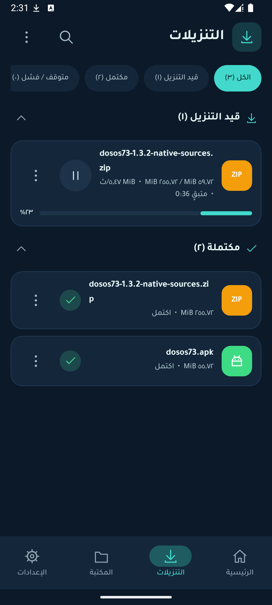 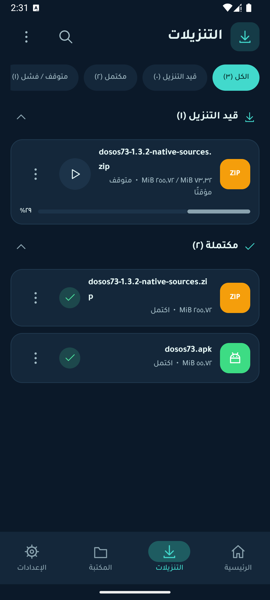

### المكتبة

تصنيفات: الكل، فيديو، صوت، تطبيقات، مستندات، صور، أرشيفات، برامج، أخرى. **تُخفى التصنيفات الفارغة**. يوجد بحث وفرز (الأحدث، الاسم، الحجم، تصاعدي/تنازلي) وفلتر «100 MiB فأكثر» ومجموعات، وفتح ومعاينة ومشاركة وإعادة تسمية وحذف بتأكيد (موروثة من 1.3.2 ومحفوظة).

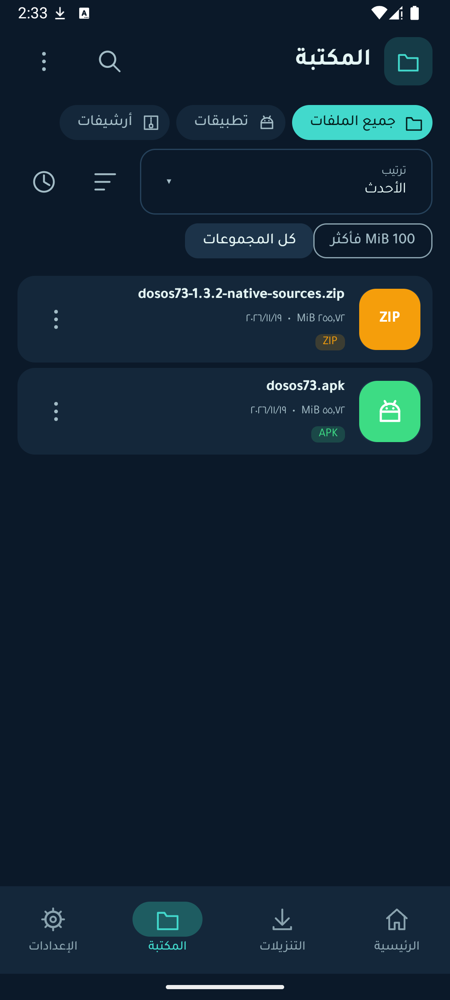

### الإعدادات

المجموعات: التنزيلات (مكان الحفظ، المساحة المتاحة الحقيقية، تحميل عدة روابط، سلوك الإيقاف)، الشبكة (Wi-Fi فقط، الشبكات غير المحدودة، اتصالان، HTTP، الروابط المشاركة، التحميل السريع)، الإشعارات (الحالة الفعلية + فتح إعدادات النظام)، المظهر واللغة، الخصوصية والأمان، الأدوات، حول. **لا يوجد خيار وهمي**: كل صف يغيّر تفضيلًا محفوظًا أو يفتح شاشة حقيقية.

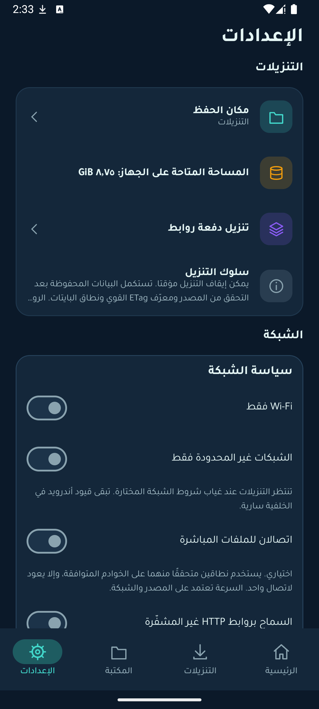

### الوضع الفاتح والإنجليزية

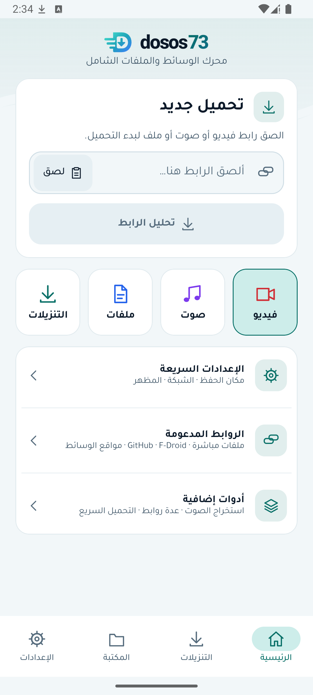 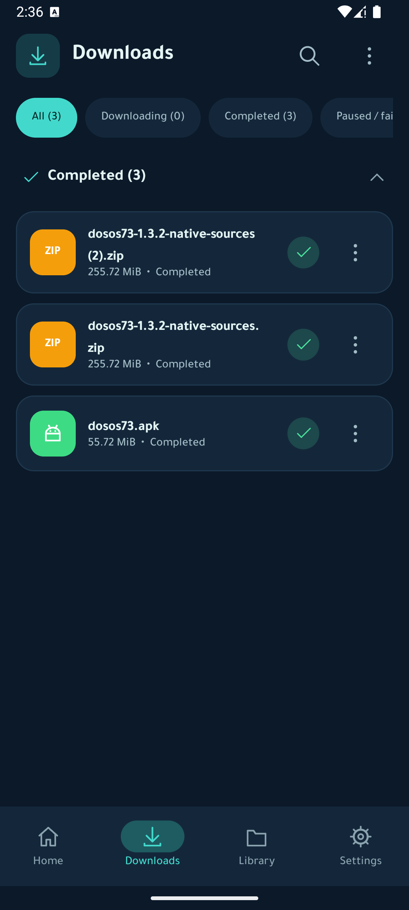

## 3) RTL / LTR

- أُزيل إجبار `LayoutDirection.Ltr` من شريط التنقل، ورؤوس الشاشات، وصفوف الملفات، وشرائح الفلاتر.
- يبقى LTR فقط في: الشعار النصي «dosos73»، والروابط وأسماء الملفات (`TextDirection.Ltr` / `ContentOrLtr`).
- الأرقام تتبع لغة الواجهة (أرقام عربية-هندية في العربية).
- أشرطة التقدم تمتلئ من اليمين في العربية، كما في المرجع.
- أسماء الملفات الطويلة تُكسر عند `.` و`-` و`_` بدل منتصف الكلمة.

## 4) إتاحة الوصول

| البند | الحالة |
|---|---|
| أهداف اللمس ≥ 48dp | كل الأزرار والصفوف (الصفوف ≥ 60dp، أزرار البطاقات 48dp) |
| أسماء للقارئ الصوتي | **أُصلح خلل وُجد أثناء الاختبار:** كان الاسم على الأيقونة الداخلية بدل الزر، فيقرأ TalkBack «زر» بلا اسم. صار الاسم على الزر نفسه (`IconAction` و`RoundAction`) |
| حالات بلا اعتماد على اللون | المكتمل = علامة + نص «اكتمل»، والفشل = نص الخطأ + أيقونة، والمتوقف = نص «متوقف مؤقتًا» |
| مناطق حية | مرحلة التحليل ونص الخطأ (`liveRegion`) |
| `fontScale` 200% | **NOT RUN** للشاشات الجديدة (يوجد اختبار 1.3.2 للمراجعة فقط)، المرحلة G |
| TalkBack يدويًا | **NOT RUN** |
| الأجهزة اللوحية / الوضع الأفقي | `Page` محدود بعرض 720dp. لقطات اللوحي **NOT RUN** |

## 5) أخطاء وُجدت وأُصلحت أثناء هذه المرحلة

| الخطأ | السبب الجذري | الإصلاح | الدليل |
|---|---|---|---|
| تنزيلات GitHub المتوقفة لا تُستأنف أبدًا، وكل إعادة محاولة تفشل (**موجود في 1.3.2**) | نقطة الاستئناف كانت مربوطة بعنوان التحويل الكامل، وGitHub/CDN يوقّع كل تحويل باستعلام جديد | الربط بالمضيف + المسار + ETag قوي + `If-Range` + طول مطابق، مع قبول نقاط 1.3.2 القديمة | `SignedRedirectResumeTest` (فشل قبل الإصلاح بـ `Changed representation` ونجح بعده). على الجهاز: إيقاف عند 73.3 MiB، ثم قتل العملية، ثم استئناف حتى النهاية. **SHA-256 للنسخة المستأنفة = النسخة غير المنقطعة = بصمة GitHub المنشورة** `2080a4d4…7260` |
| زر «استئناف» يعيد سؤال «تم تنزيله سابقًا» (من إدخالي في هذه المرحلة) | ربطتُه بمسار الإضافة للطابور بدل أمر الخدمة | يستخدم أمر الخدمة كما في 1.3.2 (الإيقاف يعمل كمفتاح تبديل) | تجربة الجهاز |
| البطاقة المتوقفة تفقد «المنزَّل / الإجمالي» | الحالة النهائية للإيقاف كانت تُنشأ بلا بايتات | تُحفظ آخر قيمة حقيقية | لقطة «متوقف» |
| أزرار بلا اسم مقروء | الاسم على الأيقونة الداخلية | الاسم على الزر | تجربة الجهاز |

## 7) الودجت والإشعارات (المرحلة E)

| عنصر المرجع (الهاتف الأيمن) | التنفيذ | الحالة |
|---|---|---|
| بطاقة كحلية بزوايا مستديرة | `widget_background` (24dp)، داكنة مع الوضع الداكن للنظام وفاتحة مع الفاتح | مطابق |
| شعار + dosos73 | مجموعة ثابتة LTR في الطرف | مطابق |
| «التنزيل النشط» + أيقونة | حالة حقيقية: لا يوجد / نشط / متوقف / بالانتظار / اكتمل / فشل | مطابق وموسّع |
| أيقونة النوع + اسم الملف | بلاطة ملونة حسب النوع. **الاسم مخفي افتراضيًا** («حزمة Android»، «أرشيف»...) ويمكن إظهاره من الإعدادات | مطابق مع خصوصية |
| نسبة + شريط + الحجم + السرعة | من التنزيل الحقيقي، بلا أرقام وهمية. التحديث كل 1.5 ث كحد أقصى | مطابق |
| «تحميل جديد» (+) و«عرض التنزيلات» | يفتحان الرئيسية والتنزيلات عبر `PendingIntent` صريح وغير قابل للتعديل | مطابق |

 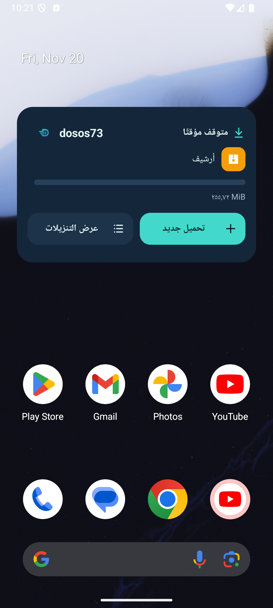 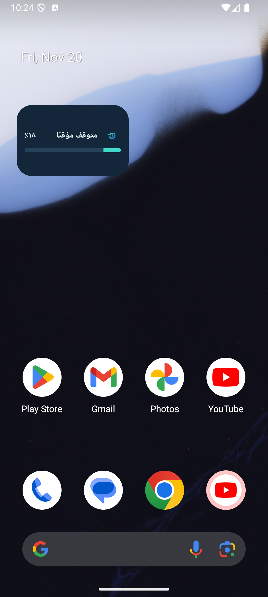

الإشعارات: التقدم مع «إيقاف مؤقت/إلغاء»، ثم «استئناف/إلغاء» بعد الإيقاف.

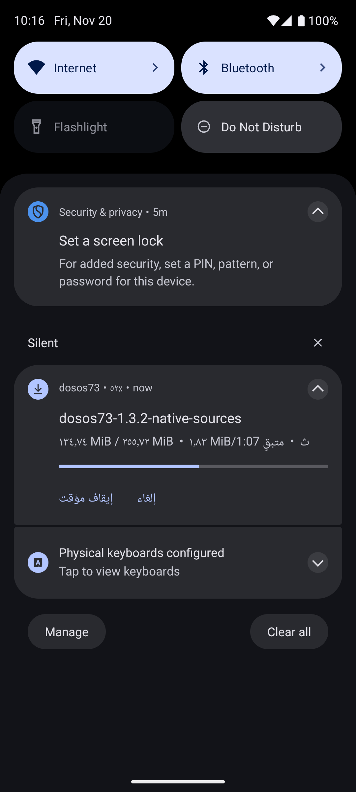 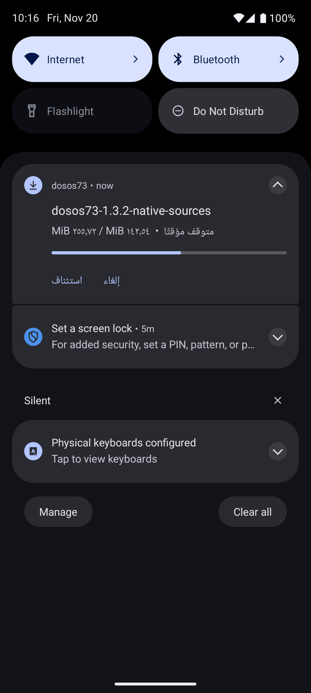

> لقطة إشعار التقدم أُخذت قبل إصلاح ترتيب النص المختلط الاتجاه (`BidiFormatter`)، لذلك يظهر فيها «MiB/ث» و«متبقٍ» بترتيب خاطئ. الإصلاح مُطبق ومغطى، ولم تُعد لقطته.

## 6) قيود صريحة

- خنق شبكة المحاكي (`adb emu network speed`) أعطى سرعات KiB/ث بعيدة عن القيمة المطلوبة، فلم يُعتمد كاختبار «اتصال بطيء». **النتيجة: NOT RUN** لاختبار الاتصال البطيء الحقيقي.
- مُقدّر الوقت المتبقي كان يتذبذب مع عينات السرعة القصيرة. **عولج في المرحلة F** (`SpeedMeter`).
- بعد إعادة تشغيل التطبيق كانت المهمة المتوقفة تظهر بالحجم الكلي فقط. **عولج في المرحلة E** (`TransferFiles.checkpoint`).
- الشعار: احتُفظ بشكل شعار المشروع الحالي (حرف D مع خطوط السرعة) بألوان الهوية الجديدة، بدل مثلث التشغيل الذي في المرجع، لأن تغيير الشعار قرار هوية يعود للمالك.
- لقطات الأجهزة اللوحية والوضع الأفقي ومقاس 360dp: **نُفذت في المرحلة G** (القسم 8).

## 8) المرحلة G: المقاسات والخط الكبير (لقطات حقيقية في `docs/vnext/screens/phaseG/`)

| الحالة | الإعداد على المحاكي | النتيجة | ما أُصلح |
|---|---|---|---|
| خط 200% | `font_scale 2.0` | المحتوى يلتف ويتمرر بلا تداخل | ثلاثة أخطاء ظهرت: (1) أسماء الملفات تُقص بعد سطرين فيختفي الرقم المميِّز «(4).zip»؛ صارت 4 أسطر عند الخط الكبير. (2) بلاطة «التنزيلات» تظهر «التنزي.». (3) عناوين الشريط السفلي «الإعدادا…». أُضيف `FitText`: يُصغّر الكلمة الواحدة حتى 60% فقط عند عدم اتساعها، بدل القص |
| عرض 360dp | `wm density 480` (1080px = 360dp) | الرئيسية والتنزيلات والإعدادات سليمة، والأزرار ≥ 48dp | — |
| جهاز لوحي | `wm size 2560x1600`، `wm density 320` (1280×800dp) | الرئيسية في عمود مركزي بعرض مقروء | قائمة التنزيلات كانت تمتد 1280dp؛ صار عرضها لا يزيد على 840dp وفي المنتصف |
| أفقي | `user_rotation 1` | يعمل ويتمرر، والحالة محفوظة عند الدوران (`RotationStateTest`، `LandscapeReviewLayoutTest`) | قيد باقٍ: الشريط السفلي يأخذ مساحة رأسية كبيرة في الأفقي. `NavigationRail` للأفقي لم يُنفذ |
| رفض إذن الإشعارات | `pm revoke` ثم «لا تسمح» في طلب النظام | التنزيل اكتمل، ولا إشعار نتيجة، ولا تعطل | — |

