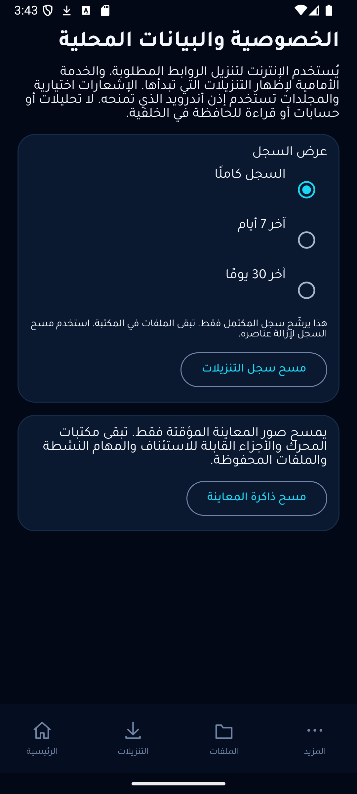

# Current delivery status (2026-10-29)

The current downloadable candidate is v1.2.0-rc.3: one signed universal APK, 72,717,048 bytes, with MP3 V0 extraction. The owner reports that the app and MP3 work correctly on their phone. This is user acceptance on that device, not a complete physical-device matrix. See MP3_ACCEPTANCE.md for emulator/network limits.

New source work after RC3 (not yet included in that APK): encrypted batch-review persistence, storage-error retry UI, and closing sockets created concurrently with proxy shutdown. 62 JVM tests, debug lint and six selected Android tests passed. A real API35 x86_64 process kill (`kill -9` under the app UID) followed by relaunch preserved both reviewed URLs and their [selected, unselected] state without starting downloads. Choice/folder round-trip and tamper preservation passed separate encrypted-journal tests. This does not prove active download resume or reboot recovery.

A live direct-transfer process-kill test also completed: a 4,372,373-byte W3C fixture had 6,836 partial bytes before kill; after relaunch one new file was published, staging was cleared, and SHA256 matched the independently downloaded reference (b670602fa00934ca27c4351bb0efe7ea7a07fae57284e44226025eeed7c51254). This establishes correct recovery/output for that case; captured evidence does not prove whether the origin honored the resumed byte range.

Open work remains: active-transfer reboot acceptance; native process cancellation-registration race; orphan publication/SAF rename crash recovery; physical network/OEM/battery matrix; resumable adaptive parallel parts; multiple active downloads; OS scheduling; subtitle sidecars; missing-file classifications; full history retention deletion; durable diagnostics; complete native/Python supply-chain correspondence. API29+ and four ABIs are the intended compatibility scope; physical coverage is incomplete.

The sections below preserve the historical RC1 baseline, including its old package sizes and test counts. They are not the current package specification.

---

# 1.2.0 charter delivery status

This branch implements a substantial increment over v1.1.2. It does not claim the entire 30-role charter is complete. Decision: ready for beta testing as 1.2.0-rc.1, not completion of the full charter. v1.1.2 remains the stable release.

| Requested feature | Implemented change | Acceptance evidence | Remaining limits |
|---|---|---|---|
| Smart Resume | Stable private staging, fsync-before-checkpoint, strong ETag/URL binding, strict Content-Range, safe 200 restart/416 fallback | Resume and hostile HTTP tests pass with exact final hashes | Direct HTTP only; date-only/no-validator sources restart; real process-kill acceptance still pending |
| Adaptive connections | Opt-in two disjoint validated ranges for known >=4MiB representations, fallback to sequential | Parallel integrity tests and three controlled comparisons pass | Bounded two connections, not a continuous throughput optimizer; partial parallel pieces restart |
| Advanced queue | Durable encrypted queue, priorities, reordering, per-waiting-task pause, active direct pause | Priority/lease/pause device tests pass | One active file; no OS-backed scheduled start or multi-active transfer engine |
| Network intelligence | Wi-Fi/unmetered policy, permitted Network DNS/socket binding including native proxy, bounded retry on policy interruption | Code review and existing network safety tests | Real Wi-Fi/cellular transition matrix not yet tested; OS foreground limits remain |
| Batch | Up to20 reviewed links, canonical dedup, per-item validation/analysis, explicit enqueue | Clipboard/mixed-invalid/dedup/UI tests pass | Uses default available choice per reviewed entry; no per-item destination category picker |
| Media options | Actual audio bitrate/language labels, reliable per-choice size, preserves multiple audio qualities | Source format fixture tests pass | No subtitle sidecar selection, no measured merge ETA |
| Smart organization | URI metadata collections, large-file filter, MIME/name search; inaccessible index entries retained | Existing library tests pass | Missing-file status distinction and all collection/rename edge cases need more coverage |
| Offline experience | Local content URI image/video/audio preview via platform components, bounded image decode, external fallback | Implementation reviewed, UI opens basic routes | Exhaustive codec/corrupt-source/device playback matrix pending |
| Privacy center | Encrypted queue/failure journals via Android Keystore, bulk history hiding distinct from files, thumbnail cache clearing | Encryption/migration/tamper test and safe-report test pass | History days is visibility filtering, not automatic data deletion; no claim of complete forensic erasure |
| Diagnostics | Localized offline/404/server classifications and allowlisted copy/share report | Classifier and export exclusion tests pass | No durable per-task diagnostic timeline |

## Confirmed repairs

- Preserve old SAF grants while queued/active/saved URIs may need them (MainActivity).
- Preserve inaccessible SAF index records and remove silent 2000-entry truncation (LibraryRepository).
- Commit queue/failure journal state to disk before publishing in-memory state; reject corrupt journal instead of replacing with empty data (DownloadQueue, FailureJournal, PrivateJournal).
- Distinguish user cancellation from system interruption; retain direct partial data and durable ownership as appropriate (DownloadService).
- Verify destination content hash and byte count even if provider reports unknown size (OutputStore, StreamIntegrity).
- Durable publication receipt recovers verified MediaStore row rather than duplicating download; SAF ambiguous rename is fail-closed, not blindly deleted (PublicationReceipt).
- Prevent system HTTP proxy bypass of direct public-DNS policy (DirectDownloader).
- Preserve incoming share for explicit handling while analysis is busy and canonicalize batch duplicates (MainViewModel).

## Security review and remaining risks

No new third-party dependency. Existing TLS/public-address checks retained; network-bound DNS answers still all validated. Journal authenticated encryption binds ciphertext to its filename; key stays in Android Keystore and backup remains disabled. Diagnostic export accepts only code/version/API, not task URL/title/native stderr. Direct transfer requires identity encoding and never combines mismatched validators/ranges. Output comparison detects same-size corruption with bounded buffers.

Remaining: native extractor helper proxy coverage, cancellation-registration race, complete native/Python license/advisory and 16KB audit; SAF rename/receipt crash ambiguity; scheduling and OEM background behavior; physical ARM/32-bit runtime validation. Publication orphan creation before receipt recording still has a narrow crash window. These are not claimed closed by successful ordinary download tests.

## Compatibility and package tradeoff

Android10/API29 or newer. Universal package contains ARM32/ARM64/x86/x86_64, not a device-model restriction. Native AAR contents and APK badging verified all four. Smaller per-ABI signed APKs are also built; universal grows because all native engines are included. No remote runtime fetch on first paste and no permanent watchdog. Android9 and earlier, TV-specific controls, every OEM and every codec are not certified.

## Current measured evidence

58 JVM tests pass; debug lint/build pass; local API35 instrumentation OK(37 tests), with opt-in network tests skipped separately. Live W3C MP4 download/publication/MediaPlayer test passed separately. Signed universal release builds, installs over existing official signature and analyzes YouTube after clean native package extraction. YouTube 720p transfer completed (29.39MiB) and local in-app preview rendered the saved video. CI build and APIs29/33/35/36 all passed: https://github.com/taroq4-2/dosos73/actions/runs/40627903031. Clean-data startup was verified under isolated emulator user10 without deleting original user data; then switched back to user0.

Controlled4MiB fixture: sequential794/781/784ms, two connections376/450/378ms, every final SHA matched. No general internet/battery speed claim. Baseline coldstart and memory samples are in CHARTER_EXECUTION.md; after coldstart samples637/425/332ms and immediate PSS52332KiB/RSS123052KiB. Baseline1355/454/666ms, PSS38575KiB/RSS124616KiB. Small samples after different accumulated app/test state are noisy; do not infer a general speed or memory improvement. CPU/battery/failure population metrics not measured.

## Artifacts and source

Built application source: `0de91a5`; later commits contain documentation/screenshots only. Version1.2.0/code9, same production certificate as1.1.2. Universal204892299 bytes; ARM6459507578; ARM3252854444; x8658095732; x86_6462499577. Every APK passed apksigner verification. SHA256SUMS accompanies the release. Signed universal was installed and exercised; architecture-specific ARM/x86 packages were verified structurally, not executed on those CPUs. No AAB required for GitHub distribution.

## Authentic captures

## Final approval boundaries

Ready for beta testing. Not approved as a complete implementation of all ten charter specifications: scheduling/multiple active jobs, subtitle selection, full retention deletion, complete diagnostic timelines, actual network handoff/kill/OEM matrix and full native supply-chain audit remain. Existing stable release and user data are preserved. The new branch and PR provide reviewable source, and a prerelease supplies the tested APK rather than presenting incomplete scope as a final stable replacement.
