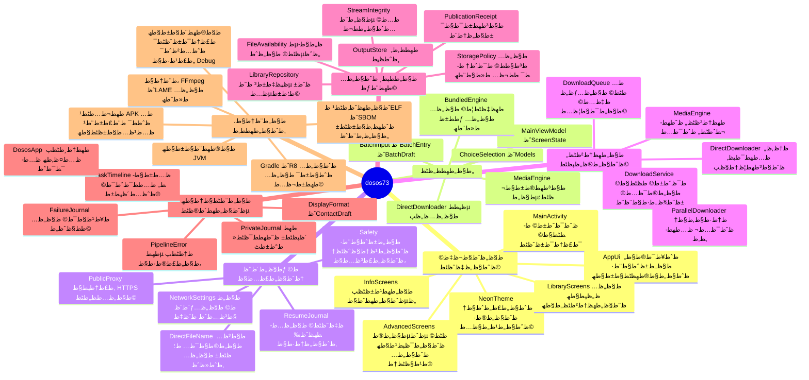
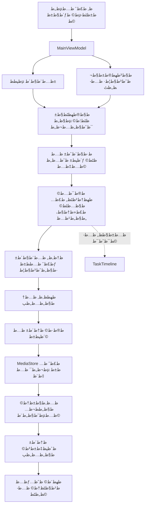

# ط®ط±ظٹط·ط© ظ…ط´ط±ظˆط¹ dosos73

ط§ظ„ط®ط±ظٹط·ط© ظ…ط¨ظ†ظٹط© ط¹ظ„ظ‰ ظ‚ط±ط§ط،ط© ظ…ظ„ظپط§طھ Kotlin ط§ظ„ط­ط§ظ„ظٹط© ظƒط§ظ…ظ„ط©طŒ ط¨ظ…ط§ ظپظٹظ‡ط§ ط§ظ„ط§ط®طھط¨ط§ط±ط§طھطŒ ظˆظ…ظ„ظپط§طھ ط§ظ„ط¨ظ†ط§ط، ظˆط§ظ„ظ…ظˆط§ط±ط¯. ظ„ظ‚ط·ط© ط¬ظ…ظٹط¹ ط§ظ„ظ…ظ„ظپط§طھ ط§ظ„ظ…طھطھط¨ط¹ط© ظˆط£ط­ط¬ط§ظ…ظ‡ط§ ظˆط¨طµظ…ط§طھظ‡ط§ ظپظٹ [ط§ظ„ط¬ط±ط¯](audit/baseline-inventory.json). ط§ظ„ط«ظ†ط§ط¦ظٹط§طھ ظ„ظٹط³طھ ط´ظٹظپط±ط© Kotlin: ظپط­طµ ط¬ط±ط¯ظ‡ط§ ظˆطھظˆظ‚ظٹط¹ظ‡ط§ ظˆطھط´ط؛ظٹظ„ظ‡ط§ ظ„ط§ ظٹط³ط§ظˆظٹ ظ‚ط±ط§ط،ط© ظƒظ„ ظ…طµط¯ط± طھط¨ط¹ظٹط© ط®ط§ط±ط¬ظٹط© ط£ظˆ ط¥ط«ط¨ط§طھ ط®ظ„ظˆظ‡ط§ ظ…ظ† ط§ظ„ط¹ظٹظˆط¨.

## ط§ظ„طھظƒط±ط§ط± ط§ظ„ظ…ط±طµظˆط¯ ظ‚ط¨ظ„ ط§ظ„طھط¹ط¯ظٹظ„

- ظپط­طµ Content-Encoding ظˆظ†ظˆط¹ ط§ظ„ط§ط³طھط¬ط§ط¨ط© ظ…ظƒط±ط± ط¨ظٹظ† ط§ظ„طھظ†ط²ظٹظ„ ط§ظ„ظ…ط¨ط§ط´ط± ظˆط§ظ„ظ…طھظˆط§ط²ظٹ.
- ظ…ط³ط§ط±ط§ طھط­ظ„ظٹظ„ ط§ظ„ط±ط§ط¨ط· ط§ظ„ظˆط§ط­ط¯ ظˆط§ظ„ط¯ظپط¹ط© ظٹظƒط±ط±ط§ظ† ط§ط®طھظٹط§ط± ط§ظ„ط´ط¨ظƒط© ظˆط§ظ„ظپط­طµ ظˆط§ظ„ط±ط¬ظˆط¹ ظ„ظ„ظ…ط­ط±ظƒ.
- ط¥ط¹ط¯ط§ط¯ط§طھ ط§ظ„ط´ط¨ظƒط© طھظƒط±ط± طµظپ ط§ظ„ظ…ظپطھط§ط­ ظˆظ…ط¹ط§ظ„ط¬ط© ط§ظ„ط­ظپط¸ ظˆط§ظ„ط±ط³ط§ظ„ط©.
- ط§ظ„ظ†ط´ط§ط· ظٹط¬ظ…ط¹ ط§ظ„طھظˆط¬ظٹظ‡ ظˆط§ظ„ط¥ط¹ط¯ط§ط¯ط§طھ ظˆط§ظ„ط­ظˆط§ط± ظˆط¥ط·ظ„ط§ظ‚ ط§ظ„ط£ط¯ظˆط§طھط› ط§ظ„ط®ط¯ظ…ط© طھط¬ظ…ط¹ ط§ظ„ط¥ط´ط¹ط§ط±ط§طھ ظˆط§ظ„طھظ†ظپظٹط° ظˆط§ظ„طھط®ط²ظٹظ†.
- ط§ط´طھظ‚ط§ظ‚ ظ…ط¬ظ…ظˆط¹ط§طھ ط§ظ„ظ…ظƒطھط¨ط© ظˆطھظ‡ظٹط¦ط© ظ…ظ†ط³ظ‚ط§طھ ط§ظ„ط£ط±ظ‚ط§ظ… ظˆط§ظ„طھط§ط±ظٹط® ظٹطھظƒط±ط± ط¹ظ†ط¯ ط¥ط¹ط§ط¯ط© ط§ظ„ط±ط³ظ….
- ط§ظ„ط¹ظ„ط§ظ…ط© ط§ظ„ط¯ط§ط®ظ„ظٹط© طھظپظƒ طµظˆط±ط© ظƒط§ظ…ظ„ط©طŒ ط¨ظٹظ†ظ…ط§ ط£ظٹظ‚ظˆظ†ط© ط§ظ„طھط·ط¨ظٹظ‚ ظ„ظ‡ط§ ط£طµظ„ ظ…طھط¬ظ‡ظٹ ظ…ط³طھظ‚ظ„.

ط§ظ„ط£ط³ظ…ط§ط، ظˆط§ظ„ظ…ط³ط¤ظˆظ„ظٹط§طھ ظ‡ظ†ط§ طھطµظپ ظ„ظ‚ط·ط© ط§ظ„ط¨ط¯ط§ظٹط©. ظٹط³ط¬ظ„ طھظ‚ط±ظٹط± ط§ظ„ظ…ط±ط§ط¬ط¹ط© ط§ظ„طھط؛ظٹظٹط±ط§طھ ط§ظ„ظپط¹ظ„ظٹط© ظˆظ†طھط§ط¦ط¬ظ‡ط§ ط¨ط¹ط¯ ط§ظ„طھظ†ظپظٹط°طŒ ظˆظ„ط§ طھط¹ظ†ظٹ ط§ظ„ط®ط±ظٹط·ط© ط£ظ† ظƒظ„ ط¨ظ†ط¯ ط³ط§ط¨ظ‚ ط£ظˆ ط¬ط¯ظٹط¯ ظ…ط؛ظ„ظ‚.
