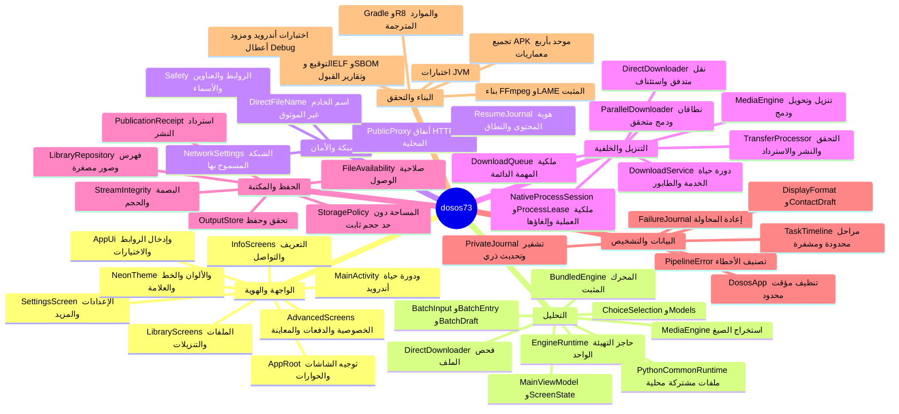
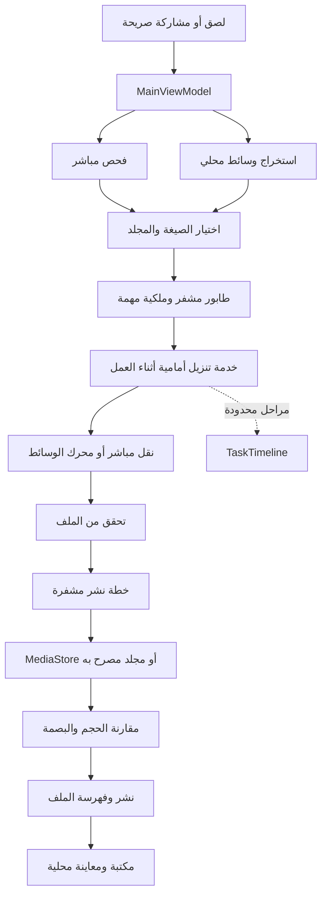

# خريطة مشروع dosos73

الخريطة مبنية على قراءة ملفات Kotlin الحالية كاملة، بما فيها الاختبارات، وملفات البناء والموارد. لقطة جميع الملفات المتتبعة وأحجامها وبصماتها في [الجرد](audit/baseline-inventory.json). الثنائيات ليست شيفرة Kotlin: فحص جردها وتوقيعها وتشغيلها لا يساوي قراءة كل مصدر تبعية خارجية أو إثبات خلوها من العيوب.

## التكرار المرصود قبل التعديل

- فحص Content-Encoding ونوع الاستجابة مكرر بين التنزيل المباشر والمتوازي.
- مسارا تحليل الرابط الواحد والدفعة يكرران اختيار الشبكة والفحص والرجوع للمحرك.
- إعدادات الشبكة تكرر صف المفتاح ومعالجة الحفظ والرسالة.
- النشاط يجمع التوجيه والإعدادات والحوار وإطلاق الأدوات؛ الخدمة تجمع الإشعارات والتنفيذ والتخزين.
- اشتقاق مجموعات المكتبة وتهيئة منسقات الأرقام والتاريخ يتكرر عند إعادة الرسم.
- العلامة الداخلية تفك صورة كاملة، بينما أيقونة التطبيق لها أصل متجهي مستقل.

الخريطة محدثة بعد فصل النشاط والخدمة وإضافة ملفات المحرك المشتركة. يسجل تقرير المراجعة التغييرات الفعلية ونتائجها بعد التنفيذ، ولا تعني الخريطة أن كل بند سابق أو جديد مغلق.
