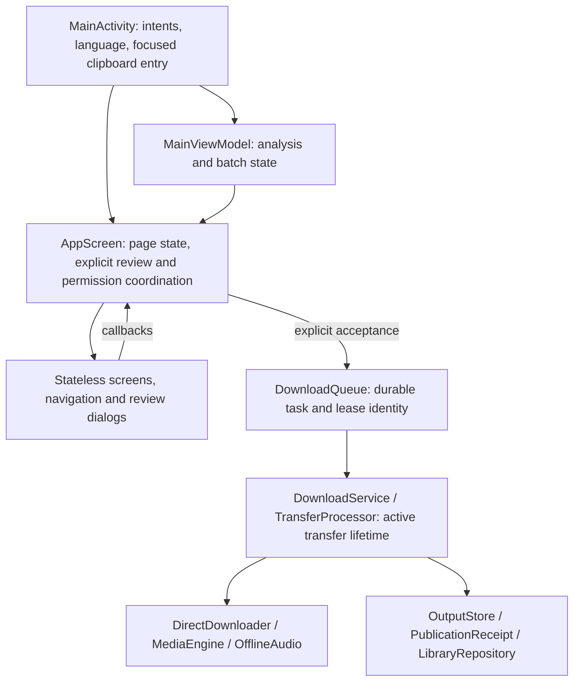

# Architecture, experience and measurement review

Review date: 2 November 2026. Source baseline: `bcfcdbdf46ba0f9e18dcfad50fa8fb8220312b9e`.
This is one AI-assisted review workstream covering several virtual specialist
functions, not fifteen independent reviewers or a physical-device certificate.
The final source SHA, Android test results and artifact identity belong in the
root release-readiness report after integration.

## Verified changes

| Item | Classification / priority | Reproduction or source evidence | Change | Regression evidence / status |
|---|---|---|---|---|
| A12 | Maintainability opportunity, P2 | `AppRoot.kt` contained navigation presentation and three review dialogs in addition to resource/state coordination; baseline 835 lines | Extracted stateless `AppNavigation.kt` and `DownloadReviewDialogs.kt`; removed unused imports; root is 714 lines. No task, permission, storage or coroutine ownership moved | Existing `MediaToolsFlowTest` covers real Home/quick/history/preset flows; new `ReviewLayoutTest` adds three presentation/layout cases. Device execution pending integration; extraction is incremental, not completion of all architecture work |
| A13 / A01 | Layout correctness gap, P2 | Root content used `statusBarsPadding()` only, leaving no explicit horizontal safe-drawing inset for a landscape cutout/system bar | Root uses `WindowInsets.safeDrawing.only(Top + Horizontal)`; existing Scaffold bottom navigation inset and `imePadding()` remain | Requires signed APK landscape/cutout inspection and API36 matrix; do not mark all cutout/OEM configurations verified from code alone |
| A13 | Error/status usability gap, P2 | Transfer-details dialog body was not scrollable; long detail/title and 200% text can consume limited landscape height | Extracted details dialog uses the same compact-window width/title strategy as quick/history reviews, bounded scrollable body and explicit Close action | `ReviewLayoutTest.transferDetailsCanCloseWithLongContentAtDoubleFontInRealLandscape`; execution pending integration |
| A07 | Measurement gap, P1 | No matched current before/after process-start/PSS/frame dataset | Added stdlib-only host measurement harness and parser checks; no application dependency or always-on profiling | Four host parser tests passed. Device measurements must be run and their actual results reported separately |

Line-count reduction is a maintenance result, not a measured APK-size, startup
or recomposition improvement. The baseline bytecode/security/download behavior
must still pass integration tests. There is no claim of reduced CPU, battery,
RAM or download time from moving Compose functions.

## Resource and state ownership retained



| Owner | Lifetime and retained responsibility |
|---|---|
| `MainViewModel` | Analysis selection and batch state survive Activity recreation; foreground analysis jobs remain bound to the ViewModel |
| `AppScreen` | `rememberSaveable` page/input snapshots, destination permission launchers, task snapshots, notification gate, duplicate-confirmation deferred answer; its composition coroutine scope is cancelled with that screen |
| Extracted navigation/dialogs | Presentation and callback delivery only; no new global state, filesystem access, coroutine scope, receiver, sensor or network work |
| `DownloadService` / processor | Durable queue acceptance, independent native process/cancellation ownership, foreground notification, publication and retry outcome |
| `LibraryRepository` | File index/visibility and explicit refresh; extraction did not add whole-library hashing, rescans or new network requests |

The small refactor deliberately keeps task/permission coordination together.
Further separation of those coordinators is a backlog improvement requiring
dedicated cancellation/rotation tests, not an excuse for a wholesale rewrite.

## Accessibility and localization boundaries

Reviewed: English/Arabic string resources and shared UI callbacks, named icon
buttons with 48dp minimum bounds, explicit switch/button roles, polite status
announcements, the existing contrast test, navigation, quick/history review and
details dialogs. The navigation order and existing cyan/blue/violet appearance
are preserved. Existing `DesignContrastTest` checks normal-text 4.5:1 contrast
for the specified foreground/background pairs; it is not an audit of every
rendered gradient, disabled state or image.

New presentation tests use RTL and 200% density font scale; the details test
also rotates the real instrumentation window to landscape and restores free
rotation in `finally`. The duplicate test checks Open/Again/Cancel separately;
only Open scrolls its body ancestor, while fixed action-row buttons must already
be visible. Arabic fixtures use actual Arabic characters.

**NOT RUN in this workstream:** physical TalkBack/Switch Access journeys,
external keyboard navigation, every accessibility service/OEM, a light theme
(the current product has a deliberately dark palette), foldable hinge handling,
large-screen desktop resizing and actual Android16 cutout screenshots. Semantics
tests and a successful CI job do not substitute for those experiences. No light
theme or new layout was advertised without implementation.

## Reproducible matched performance measurements

Run on the owned, idle test device only. Install the corresponding signed APK
separately; do not uninstall it or clear user data for a comparison. First check
that there is no queued/active transfer. The harness refuses a running download
service, and requires an explicit force-stop acknowledgement.

```text
python tools/measure_performance.py --adb <adb-path> --serial emulator-5560 --label bcfc-rc1-baseline --output <new-path>/before.json --runs 10 --allow-force-stop
python tools/measure_performance.py --adb <adb-path> --serial emulator-5560 --label readiness-rc2 --output <new-path>/after.json --runs 10 --allow-force-stop
python tools/test_measure_performance.py
```

Use identical emulator image, persisted data, app language/theme, window size,
density, font size, settling time and host workload; record installed version
and compare exact signed artifacts. The process is force-stopped for each
sample; OS disk caches remain intact. Outputs include raw `am start -W`,
`dumpsys meminfo` and `dumpsys gfxinfo ... framestats` for every run, device/build
metadata, median and nearest-rank P95. Frame durations exclude flagged/incomplete
frames. Empty frame output stays a zero-sample/null statistic rather than a pass
or invented zero milliseconds. No media, application data, caches, or global
battery statistics are deleted. This host tool adds zero APK runtime dependencies.

Before interpreting results, use a **10% startup/PSS regression investigation
threshold** under those matched conditions; isolated P95 movement in ten samples
needs repeated controlled measurement before an optimization claim. This is a
diagnostic threshold, not a physical-device performance acceptance certificate.
No performance tuning is claimed in this UI refactor.

These samples measure process-cold startup, startup/settling frames and snapshot
PSS. They do **not** measure scrolling jank, display input latency, CPU energy,
GC rate, multi-hour thermal behavior, network throughput or physical battery
drain. Physical low/mid/high ARM measurements, Perfetto traces, long transfers
and controlled battery tests remain necessary for full A07 closure.

## Virtual role contributions and cross-review

| Role | Concrete contribution / reviewed locations | Evidence / disposition |
|---|---|---|
| 01 Android architect | UI/service/storage ownership map; extracted presentation only | `AppRoot.kt`, diagram above; retained domain ownership |
| 02 Kotlin reviewer | Callback signatures, imports, cancellable scope retention | No new singleton/scope/resource owner; integration compile pending |
| 03 Compose expert | Extracted navigation and review components; adaptive dialog sizing | Three `ReviewLayoutTest` cases pending device execution |
| 04 State-management expert | Page/saveable state, quick/history answer ownership, launcher callbacks | Original state remains in root; existing real flow tests required |
| 05 Duplication/refactoring | Shared compact review modifier and stateless component boundaries | Root 835→714 lines; no runtime speed claim |
| 26 Network performance | Confirmed UI extraction adds no network requests | Throughput comparison NOT RUN; direct transfer ownership unchanged |
| 27 CPU/battery | Kept profiling out of APK and avoided permanent observers | Physical power/thermal testing NOT RUN |
| 28 RAM/GC | Host-side PSS capture, bounded raw diagnostics collection | PSS parser tests passed; GC/device metrics pending |
| 29 Startup/jank | Reproducible process-cold launch and frame capture harness | Four parser tests passed; startup-only scope explicit |
| 30 APK/ABI size | No new Android/native dependency; universal distribution retained | Final compact APK bytes and AAB delivery measured by release owner |
| 31 Arabic RTL | RTL navigation/review checks and real Arabic long strings | Automated cases added; human language/TalkBack acceptance pending |
| 32 English LTR | Shared resource IDs/callbacks unchanged | Existing English Activity-flow regression required |
| 33 Accessibility | 48dp navigation checks, explicit three-action review, contrast evidence | Manual TalkBack/Switch Access remain NOT RUN |
| 34 User journeys/errors | Preserved explicit Open/Again/Cancel and quick Start gating | Real `MediaToolsFlowTest` required after refactor |
| 35 Adaptive UI | Safe horizontal/top insets; landscape/large-font details dialog | Device/API36 matrix and visual acceptance pending integration |

Root release owner must cross-review extracted callback equivalence and record
the actual build/device results before changing “pending” to passed. These
functions share evidence and are not represented as independent human approvals.

## Cross-review of A02 release tooling

The release owner requested a separate review of the new APK/AAB assembler,
verifier, synthetic tamper tests and CI. Three reproducible verification gaps
were corrected in `tools/verify_bundle.py`:

1. Comparing only native files present in the bundle accepted a missing
   executable while all four ABI directories remained. The verifier now checks
   exact native path-set equality against the compact APK before byte equality.
2. `jarsigner -verify` can exit zero and print `jar verified.` after an unsigned
   entry is appended. This was reproduced with a real ephemeral JDK-signed JAR;
   the fixed verifier rejects its unsigned-entry warning. A self-signed upload
   certificate remains valid for this integrity check; public CA trust is
   explicitly not claimed. The owner must compare its certificate fingerprint.
3. The observed `versionName` was reported but not checked against the expected
   release. It is now a required `--version-name` argument alongside versionCode,
   package ID, minimum and target SDK.

Security-relevant assertions in this verifier now raise explicit exceptions so
Python optimization cannot disable them. `tools/test_release_packaging.py`
contains **12 passing tests** (four original and eight added), run both normally
and with `python -O`. Added cases cover a missing executable with every ABI still
present, extra native paths, changed shared runtime, the expected version name,
and unsigned/partially signed versus self-signed complete JAR outputs. The
empirical unsigned-entry fixture record is stored in the owner's raw work
evidence; it contains no production key or credentials.

The assembler retains AGP's proto manifest/resources and mapping, binds DEX and
assets to the original APK and enforces the exact native path set. Bundletool
validation and signed derived-APK installation remain separate acceptance steps;
these host tamper tests do not themselves establish device delivery or Play
approval. The pinned-action/read-only CI builds both lint variants and the AAB,
records unsigned CI status honestly, and retains API29–36 device jobs. Final
workflow success and signed-artifact acceptance must be recorded by the owner.
